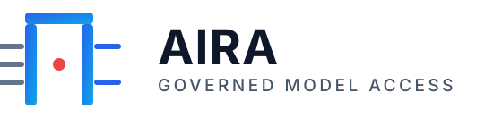
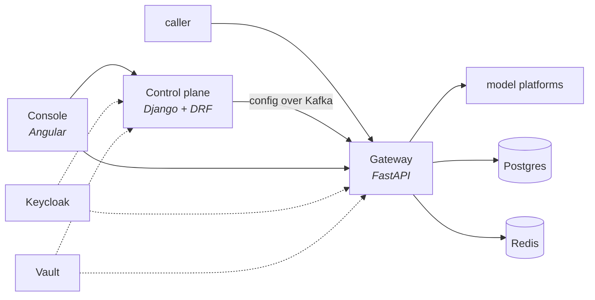
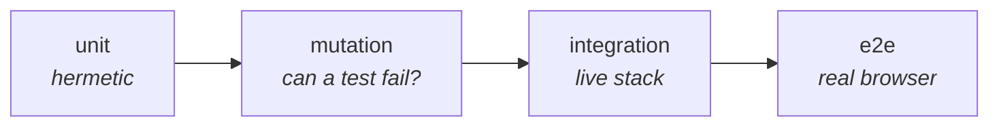

<p align="center">
  
</p>

<p align="center">
  <strong>A governed gateway for AI models.</strong><br>
  One API in front of several platforms, and a record of everything that passed through it.
</p>

---

AIRA sits between the people who want to call a model and the platforms that serve one. Every
request goes through the same controls in the same order — who is asking, on whose behalf, may they
afford it, may this model serve it — and every request it can attribute to a use case leaves a row
saying what happened, including the ones that were refused.

It is deliberately **not** an agent platform. It provides auditable model access: no conversation
state, no retrieval, no tool execution, no workflow orchestration. The test for anything proposed
is whether it makes model access better governed and better evidenced, or whether it makes the
gateway think for the use case.

---

## See it working

```bash
make showcase
```

Starts everything in containers, pulls a small local chat model and an embedding model, seeds four
use cases with budgets, rate limits, anomaly rules, a filtering pipeline and API keys, and drives
**real traffic** through the gateway — including a prompt injection the filter refuses. Then open
<http://localhost:4200>.

| Sign in as | Password | To see |
|---|---|---|
| `admin` | `demo-password` | everything, including model prices and approval |
| `itsec` | `demo-password` | security oversight, and the content of requests |
| `itgov` | `demo-password` | every figure, no write anywhere, no content |
| `ucadmin` | `demo-password` | administering three of the four use cases |
| `ucuser` | `demo-password` | a member's view |

Besides Docker it needs `make`, `curl`, `python3` and `uv` on the host: the waiting and the demo
traffic run there, and `uv` fetches the Python 3.14 they need. Step by step:
[**Showcase**](docs/deployment/showcase.md).

---

## Deployment

Four ways to run it, one page each. Written for somebody doing it for the first time.

| | For | Needs |
|---|---|---|
| [**Showcase**](docs/deployment/showcase.md) | seeing the whole product work, with real traffic | Docker, `make`, `curl`, `python3`, `uv` |
| [**Standalone**](docs/deployment/standalone.md) | running it on one machine, everything in containers | Docker, `make`, `curl`, `python3`, `uv` |
| [**Development**](docs/deployment/dev.md) | changing the code, reload on save | Docker, Python 3.14 + uv, Node 26 |
| [**Integrated**](docs/deployment/integrated.md) | your infrastructure, your Keycloak, your models | see its access checklist |

Every `make` target asks `python3` where the stack answers, so even starting it needs more than
Docker. Showcase, standalone and integrated can run the **published images** instead of building
them: `RELEASE=vX.Y.Z` on `make showcase`, `make up-full`, `make up-apps` or `make up-integrated`;
development runs from source.
The integrated one starts the applications alone, against the PostgreSQL, Keycloak, Kafka, Redis and
Vault you supply — Redis and Vault may be declined, but only explicitly.

---

## Features

What is built. What is not is under [Gaps](#gaps-stated-rather-than-implied), and the full list is
the [gap analysis](docs/GAP-ANALYSIS.md).

### Calling a model

- **Two API surfaces on one core.** The Gemini dialect (`/v1beta/models/…:generateContent`,
  `:streamGenerateContent`, `:embedContent`, `:batchEmbedContents`, and `GET /v1beta/models`) and
  the predecessor KIRA contract (`/kira/api/external`), both served by the same provider-agnostic
  pipeline. Neither is a copy of the other: a test compares the audit rows the two produce.
- **Four upstream families, one namespace.** Google Vertex AI — Gemini and Claude in EU regions,
  and the managed open models GLM and DeepSeek, which answer only at `global`; Google AI Studio;
  Microsoft Foundry, for GPT and others; and any OpenAI-compatible server you run yourself. A model
  served in several regions is tried in them in order.
- **Streaming**, as SSE for the Google SDK and as a JSON array by default.
- **Documents and images.** 15 media types; a PDF or an image must carry its format's signature
  bytes. A model that cannot read the attachment is **refused by name** — never sent the prompt
  without it, because a dropped attachment produces a confident wrong answer with a 200 and the
  caller blames the model.
- **Thinking, structured output, batch embedding with task types.** Declared per model. One flag
  says *whether*; three vendors do each of these three unrelated ways the caller never sees.
  Thinking is a **word** — `low`, `high`, whatever the vendor calls it — checked against the model
  itself rather than translated through a token table nobody could fill. Whether the
  reasoning comes back is the use case's decision.
- **Speech output.** `responseModalities: ["AUDIO"]` from a model the catalogue declares as
  speaking; the audit trail keeps the audio's description and hash, not the audio.
- **Tool calling**, carried and never executed, off by default per use case. **Prompt caching**,
  the same: off until a use case opts in.
- **Fallback chains** that skip a candidate that cannot serve the request and say which and why —
  rather than quietly answering with less than was asked for.
- **Nothing is silently dropped.** On the Gemini surface a field this gateway cannot honour is
  refused *by name* with the reason; the KIRA surface accepts a field it does not model and names it
  in the `X-AIRA-Unmodelled-Fields` response header. Strictness is one-directional: responses still
  ignore fields they do not know, or every upstream release becomes an outage.

### Governing it

- **Use cases** as the unit of everything: access, budget, limits, pipeline, retention, reporting.
  Retiring one ends its access at once and keeps its record; purging it is a second decision, by a
  different permission, after 30 days.
- **Two ways in.** API keys bound to a use case (hashed at rest, always with an end date: 30 days
  by default, 180 at most), and Keycloak OIDC bearer tokens — from one realm or several. Windows
  sign-on works through Keycloak's Kerberos federation, with nothing in AIRA changed for it.
- **Access follows the group.** A grant binds a person *or* a Keycloak group to a use case. AIRA
  never writes to your directory.
- **Three built-in roles, and the roles an installation defines.** Global Administrator, IT
  Security and IT Steuerung, each held through a Keycloak group; further roles are sets of
  permissions defined in the console. Administering or using a use case is a grant on it, not a
  role. The differences are load-bearing: [**who may do what**](docs/ROLES.md).
- **Budgets** on spend, tokens or requests — a use case's shared pot, each member's own counter, and
  the installation's own bucket for traffic that belongs to no use case — per day or per month.
  Reserved before dispatch and settled after, so concurrent requests cannot all pass a limit with
  room for one. By default a model without a price cannot serve a request a cost limit binds.
- **A caller sees their own allowance**: `GET /v1beta/me/budget` answers from the credential that
  asks, and a plugin for the OpenCode coding assistant shows it inside the session
  ([`tools/opencode`](tools/opencode/README.md)).
- **Rate limits** as token buckets over Redis, holding across replicas.
- **A pre-dispatch pipeline** per use case: an injection filter (heuristic or LLM-backed), routing
  by an LLM classifier, and a filter that replaces personal data in the prompt before the model sees
  it (`injection_filter`, `model_route`, `pii_filter`) — built in the console as a graph, with
  inline help and a dry run.
- **An approved-model catalog.** Only models catalogued **and approved** by whoever holds
  `catalog.write` — the Global Administrator, unless an installation gives it to another role — may
  be used, and a use case calls only the ones released to it. Prices, capabilities, output caps and
  regions live there, and the gateway enforces them from its own read-model rather than asking the
  control plane on the request path.
- **Residency enforced, not intended.** One list of permitted regions, EU by default
  (`AIRA_ALLOWED_REGIONS`). A model configured outside it stops the gateway at startup; a catalogued
  one is refused in the console as its region is typed, and skipped at request time. A region may
  be permitted for named models alone (`AIRA_ALLOWED_MODEL_REGIONS`), which is how GLM
  and DeepSeek are used without permitting `global` for everything. Provider, publisher and region
  are on every audit row.
- **Secrets from Vault.** AppRole and KV-v2, ranked above the environment, failing closed: a
  configured Vault that cannot be reached stops the process rather than running on a stale value.

### Evidencing it

- **Every request attributed to a use case is recorded** — served or refused. Rate-limited, over
  budget, unknown model, malformed, too large, client hung up: the log records what was *asked*, not
  only what was served. A request refused before it is attributed — no valid credential, too many
  failed attempts from one address, a use case the caller is not in or did not name — writes no
  row; its trace span is its record, marked there for the SIEM channel below — `unauthenticated`,
  `forbidden` or `unattributed`, with the status and whatever is known of the caller.
- **What it cost.** Priced from the prompt/completion split in integer nano-units. Unpriced traffic
  is counted apart, never as zero.
- **What the model was asked to run.** Tool names and counts on the audit row — never the arguments,
  which are the caller's content.
- **Spend and usage reporting** with breakdowns by use case, model and member, and a CSV export that
  is a renderer of the same endpoint rather than a second one. A **register of processing
  activities** lists per use case its purpose, its released models and where they run, its
  retention, controls and members — and where its traffic actually went.
- **Usage over time**: a column per day or hour split by model, use case or outcome, and the whole
  period as one row of blocks — on the reporting screen and on each use case's own overview. Spend,
  requests and tokens are three views of one load, and the figures are a table as well as a picture.
- **A request browser**, across use cases for the roles that investigate and inside one for the
  people who run it: which system, whose identity, which machine, what the pipeline objected to.
- **The prompts and answers themselves**, for the roles entitled to them — and **every read writes
  a record** of who read what, when, and on what authority.
- **Strict data mode, on by default**: nobody but the Global Administrator and IT Security sees
  what a named colleague did. Content is not stored or readable by those two only; figures per
  person, the name and key on a request and the person a finding names are withheld from everybody
  else, and nobody sees latency per person. Switched off, each use case decides as far as its
  `payload_visibility` allows (`members`, `own` or `oversight`). See [`docs/ROLES.md`](docs/ROLES.md).
- **Anomaly detection.** Seven rule kinds in a closed vocabulary — refusal rate, error rate, spend
  spike, request spike, a new source address for a credential, payload size, blocked-prompt rate —
  evaluated against the request log, including refusals. `alert` is the default because a system
  whose first setting is `block` blocks wrongly once and is switched off forever.
- **Incident response.** A suspension is a written decision with a target, an expiry, an author and
  a reason; it is read at the one pre-dispatch gate and kept after being lifted.
- **Per-use-case retention** for stored prompts, seven days by default, with payload storage
  switchable per use case and a kill switch above it.
- **Pipeline tests.** A standing catalogue of 100 questions, kept by Global Administrators and IT
  Security and put to **a use case's own pipeline** by whoever administers it — so the answers say
  whether the filter, the router and the redactor somebody configured hold up, and a blocked
  question is a result rather than a broken run. Answers are judged by a person whose name the
  verdict carries, and a use case's standing is its **latest** run, not an average an old,
  since-corrected result drags down forever. Testing a *model* is simply a use case whose pipeline
  starts at it. CSV export for the numbers.
- **A privacy notice** written from a register of what both planes store, which the test suite holds
  to the schema; shown before somebody works, again when it changes and, by default, each month — in
  German and English.
- **Delivery to a SIEM.** A second OTLP channel carries one record per API access and per model
  access — refused access attempts included — to any OTLP consumer, with recipes for Splunk HEC,
  Azure Monitor and OAuth2 ([`deploy/compose/otel/recipes`](deploy/compose/otel/recipes/README.md)).
  Its records are spans, so it needs tracing switched on.
- **Tracing**, once switched on (`AIRA_OTEL_ENABLED`, off by default): `aira.*` span attributes and
  the trace id in an `x-trace-id` header on every traced response. Which requests are sampled is the
  installation's decision (`AIRA_OTEL_SAMPLE_RATIO`), never the caller's `traceparent` flag — and a
  ratio below 1 thins the SIEM channel too, because its records are spans.

---

## How it is built



The two planes share nothing but events. The gateway never calls the control plane on the request
path, so a control-plane outage costs configuration changes, not traffic.

Full picture: [**Architecture**](docs/ARCHITECTURE.md) ·
[**One request end to end**](docs/REQUEST-LIFECYCLE.md).

---

## Documentation

| | |
|---|---|
| [**Roles**](docs/ROLES.md) | Who may do what, completely |
| [**Deployment**](docs/deployment/) | Showcase · standalone · development · integrated |
| [**Architecture**](docs/ARCHITECTURE.md) | Context, containers and components |
| [**Request lifecycle**](docs/REQUEST-LIFECYCLE.md) | Every control, in order, and what skipping one costs |
| [**API reference**](docs/API.md) | The gateway's and Management's HTTP APIs and the events between them |
| [**Configuration**](docs/CONFIGURATION.md) | Every variable, what it does, what breaks without it |
| [**Configuration files**](config/README.md) | One YAML per installation, naming every external system — and no secrets |
| [**Integrations**](docs/INTEGRATIONS.md) | What each connected system must provide |
| [**Migrating a KIRA client**](docs/MIGRATION-KIRA.md) | Use case, released models, members, key — and `X-AIRA-Use-Case` |
| [**Pointing a Gemini client at AIRA**](docs/MIGRATION-GEMINI.md) | The same steps, for `google-genai` and anything that speaks it |
| [**Operations**](docs/DEPLOYMENT.md) | Deploying it: §0 is a runbook for an integration, in order, with the command that checks each step. Then topics, jobs, degradation, backups |
| [**Sizing**](docs/DEPLOYMENT.md#1a-sizing-what-one-instance-carries) | What one instance carries, measured: the CPU a request of each workload costs, the three places a deployment gives way, and what the audit trail fills |
| [**Releasing**](docs/DEPLOYMENT.md#1b-releasing-cutting-a-version-and-publishing-the-images) | Cutting a version: an annotated tag whose message is the release notes, checked before anything is published. Where the version lives, what gates a release, and what a failure leaves behind |
| [**Running a release**](docs/deployment/integrated.md#5a-running-the-published-images-against-your-infrastructure) | The published images, pulled rather than built: `RELEASE=vX.Y.Z` on `make up-integrated` (or `make up-apps`, `make up-full`, `make showcase`), and the six addresses an integrated deployment is required to supply |
| [**Testing**](docs/TESTING.md) | The four layers and why each exists |
| [**Gap analysis**](docs/GAP-ANALYSIS.md) | Requirements against what is built |
| [**Contributing**](CONTRIBUTING.md) | How the project is developed, and where its decision records live |

---

## Building it

```bash
make sync   # dependencies
make ci     # the hermetic gates: lint, types, unit tests with coverage
make help   # every target
```

`make ci` is the half of CI that needs no stack. CI also starts the full stack twice — once for the
integration suite, once for the browser suites — which `make test-integration` and `make test-e2e`
run locally.

Four test layers, each for what the one below cannot see:



A green test proves that the code and the test agree — which they inevitably do when both came from
the same idea. So each guarded property is broken on purpose and the tests are required to notice.
The layers above unit exist because each has caught defects the one below structurally could not.

Capacity is measured rather than assumed: `make loadtest-up` puts a free stand-in upstream behind the
gateway and `make loadtest` drives a scenario against it ([**Sizing**](docs/DEPLOYMENT.md#1a-sizing-what-one-instance-carries)
has the results).

Details: [**Testing**](docs/TESTING.md).

---

## Gaps, stated rather than implied

- **One gateway instance.** Several instances behind a load balancer, and the rolling update that
  needs them, are not provided: Compose cannot scale the gateway, and nothing enforces the schema
  rule two versions serving at once depend on.
- **The audit trail is not an event stream.** A SIEM receives a span per request through the
  delivery channel, not the audit rows themselves.
- **No fallback once a stream is under way.** A streamed answer cannot move to the next candidate
  after its first chunk is on the wire, and a failed model is not retried.
- **Tool results are not scanned.** The injection filter reads the user's messages, or the system
  and user messages; a file an assistant read or a page it fetched reaches the model unscanned.
  A third scope that would put tool results through the same check is proposed, not built.
- **Configuration changes are not audited, roles apart.** A role change is logged with the role
  before and after; API keys, group grants, retirements and suspensions record who made them. Model
  approvals and prices, budgets, rate limits, pipelines, anomaly rules and use-case settings record
  neither who changed them nor what they were before.
- **No versioned event schemas.** The planes exchange JSON events named by an `event_type` header,
  with no version field; tests across both planes keep their vocabularies in step. The Compose stack
  runs a Schema Registry that no code uses.
- **Personal data in stored payloads is not redacted on storage** — declined, not deferred.
  Credentials are masked; names and customer numbers are what the payload is stored *for*. The
  controls are a `pii_filter` step, which rewrites the prompt before dispatch so that the rewritten
  one is what is stored, the per-use-case storage switch, `payload_visibility`, and a record of
  every read.
- **No alert delivery.** Findings appear in the console; nothing sends mail or calls a webhook.
- **No Kubernetes or Helm charts.**
- **Microsoft Foundry is untested against a real Azure subscription.**

The full list with consequences: [**Gap analysis**](docs/GAP-ANALYSIS.md).

---

## Licence

Apache License 2.0 — see [`LICENSE`](LICENSE) and [`NOTICE`](NOTICE).
Documentation and code are written in English.
