# Architecture

The C4 view of AIRA Gateway: context, containers, components, and the decisions that shape them.

**It is meant to be readable on its own, and it starts plainly.** §1 says what the thing is in
ordinary words — the console, the gateway, and who stands in front of each. §1a adds the objects it
governs and the two loops it runs. §3a maps every directory in the repository onto that picture, so
a reader can go from a box in a diagram to the code behind it without asking anybody. Everything
after those is depth, and every link is a pointer to *more*, never to something needed in order to
follow the argument.

For the same request told control by control, with what each one costs if it is skipped, see
[`REQUEST-LIFECYCLE.md`](REQUEST-LIFECYCLE.md).

> **Diagrams render on GitHub.** They are Mermaid, so they also render in most IDEs and in any
> Markdown viewer with Mermaid support. Where a diagram would only restate a list, there is a list.

---

## 1. What this is

### In plain words

AIRA stands between an organisation's people and programs on one side, and the companies that sell
AI models on the other. Without it, whoever wants a model calls Google or Microsoft directly with a
key somebody pasted somewhere, and afterwards nobody can say who asked what, what it cost, or
whether it should have been allowed at all. AIRA is the one door they all go through instead.

It has **two halves**, and what separates them is who is standing in front of it.

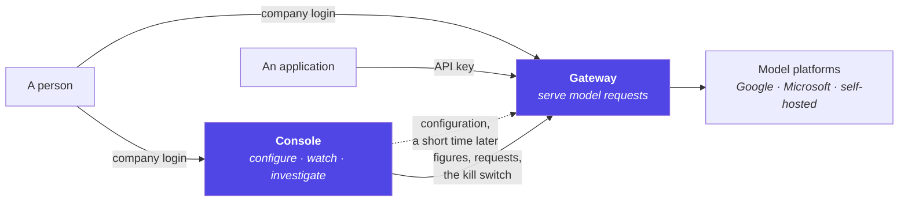

#### The console — where people work

A web page. A person signs in with their ordinary company login; AIRA never sees a password. What
they can do there depends on which groups they are in:

- A **use-case administrator** sets up and runs one purpose — "customer service chatbot", "coding
  assistant". They choose which models it may use, who may use it, how much it may spend a day, how
  fast requests may arrive, what is checked on each prompt before it is sent, and how long prompts
  are kept.
- **IT Security** writes the rules that watch the traffic, reads what those rules found, and can
  stop a use case or a single person immediately.
- **Governance** reads what was spent, by which use case and which person, and changes nothing.
- A **global administrator** maintains the list of models everybody may choose from, and their
  prices.
- A **member** of a use case sees that use case's own traffic — and, where permitted, the prompts
  themselves. Every such read is itself recorded.

**The console never talks to a model.** Three of its buttons make the *gateway* place a call.
Trying a pipeline out before saving it, and putting the question catalogue to a use case, travel
the ordinary path inside that use case, with the signed-in person's own identity on them. The
model editor's check of a model's thinking words sends one-token generations: billed, recorded as
`diagnostic` rows that belong to no use case and count against no budget, and open only to holders
of `operations.diagnose`. Two more buttons make the gateway ask a platform about itself without
generating anything: whether a model is reachable, and which models a provider offers for import.

#### The gateway — where programs work

An HTTP API. An application sends its prompt here instead of to the vendor: a chatbot with a
document search in front of it, a coding assistant inside somebody's editor, a job that runs
overnight turning a document store into vectors. It proves who it is with an **API key that belongs
to exactly one use case**, or — when a person is driving it — with the same company login the
console uses.

For every request, the gateway does what a direct call to a vendor cannot:

1. decides whether this caller may work at all right now — not stopped, not too fast, not out of
   money;
2. runs that use case's own checks over the prompt;
3. picks a model this use case is allowed to use **and** that can actually do what was asked;
4. sets the money aside before spending it;
5. forwards the request to whichever platform hosts that model, in that vendor's own format;
6. writes down what was asked, what was decided, what was served and what it cost — including when
   it refused, once it knows who is calling and for which use case (a caller turned away before
   that, with no valid credential or for a use case it may not use, is recorded on its trace
   instead);
7. returns the answer in the same format the caller sent.

A caller never has to know which company hosts the model. It names a model; the gateway knows where
that model lives and how to speak to it.

#### Who decides what — AIRA and the identity provider

**Keycloak answers who somebody is and which groups they are in. AIRA answers what those groups may
do.** Neither does the other's job, and everything below follows from that one split.

AIRA therefore decides access from two things in a token: the **person** and their **group
paths**. Beside them it keeps which application obtained the token (`azp`, or `client_id` for a
service account), which goes onto the audit row. It reads no Keycloak roles — assigning a realm role
called `global-admin` to somebody has
no effect here — and it **never writes to the directory**: it creates no group, fills none, deletes
none.

Access is decided in two layers, on purpose:

- **Across the installation.** A group path maps to a role (`/aira/it-security` → IT Security); a
  role holds named permissions; a caller's permissions are the union over the roles their groups
  confer. Every check asks for **one permission**, never for a role.
- **Inside one use case.** A **grant** binds a group — or one named person — to that use case as
  `user` (may call it, may see its figures) or `admin` (may also change its members, keys,
  pipeline, budgets and limits). Several routes may reach the same person; the **strongest wins**.

Being allowed to administer *a* use case must never mean administering *every* use case. That is
why the two layers are separate mechanisms rather than one list of roles. The one permission that
administers every use case, `usecase.manage_all`, belongs to the console: it lets its holder act in
Management as any use case's administrator, and by itself opens nothing in the gateway — calling a
use case still takes a grant reaching it, just as seeing a use case never implies the right to act
inside it.

Every model request belongs to **exactly one use case, and names it** — with `/uc/<use-case>` in
front of the path, or the `X-AIRA-Use-Case` header — whatever the credential: a person's login, and
an API key too, which belongs to one use case and may name only that one. A request that names none
is refused, so what it is billed to is in the request and does not change when its caller is given
a second use case. The single exception is the operator's break-glass key (§8.8).

#### What this needs in Keycloak — the short list

For whoever administers the realm. Nothing here is AIRA-specific except the group *paths* you
choose, and those are yours.

| Needed in the realm | Why | Without it |
|---|---|---|
| A **client for the console**, public, authorization code + **PKCE** | The console runs in a browser and can keep no secret; PKCE stops a stolen code being redeemed by anyone else | No sign-in |
| A **group-membership mapper**: claim `groups`, **full path on**, in the *access* token, on every client whose tokens AIRA sees | Group membership is the only thing AIRA reads access from | Every group grant silently reaches nobody — a token with no groups looks exactly like one whose owner is in no group |
| An **audience mapper** putting `AIRA_OIDC_AUDIENCE` into `aud` | A token minted for another application must not be usable here; Keycloak does not add it by itself | Both services **refuse to start** outside a local environment — except the gateway in a declared demo (`AIRA_DEMO_MODE`) |
| **`preferred_username`** in the access token (Keycloak's default) | Joins a person's browser session and their API key into one identity, so per-person budgets and a kill switch aimed at a person hit both | Each credential gets its own allowance; nothing is silently shared |
| **Edit username off** in realm login settings (the default) | The name in the token decides person-grants, per-head allowances and kill switches | Somebody can rename themselves into a colleague's access |
| **Three group paths** for the organisation-wide roles, named in `AIRA_ROLE_GROUPS` | This is how Global Administrator, IT Security and IT Steuerung are held | An installation nobody can administer; Management refuses to start without a Global Administrator group |
| A **read-only service account** with `view-users` and `query-groups` — nothing else | So the console can *search* your groups and people when somebody grants access | No role can be bound to a group at all: a group nobody could check is refused rather than trusted |

**Why it has to *ask* the directory at all** — the question an administrator asks first, and the
only reason any realm-management permission is requested:

A grant names a group **path**. A path typed from memory that matches nothing produces a grant that
applies to **nobody**, and nothing about it looks wrong in the audit trail. The two kinds of binding
treat that risk differently, on purpose:

- **A role bound to a group is checked.** Before a role is bound, Management asks Keycloak whether
  the path exists (`group-by-path`) — on the role editor's *Check group* and again on save — and
  refuses the binding while Keycloak cannot be asked.
- **A use case granted to a group is checked for its shape, not its existence.** A department can
  be granted before Keycloak has its group, so onboarding one is not a two-system dance. In the
  console the group is picked from the directory search, so a typo cannot be entered there; through
  the API a mistyped path produces a grant that reaches nobody, and the console's grant list says so
  (*nobody yet*).

`view-users` is the same lookup for a grant that names **one person** instead of a group, and is
what lets the console offer a picker rather than a field for a directory id.

Three properties of that lookup are worth stating to whoever grants it:

- **Read-only, and that is all it can be.** `view-users` and `query-groups` only — no
  `manage-users`, no `manage-realm`. AIRA creates no group, fills none and deletes none.
- **"You may not look" is never read as "it does not exist."** A `403` is treated as *unknown* and
  a role binding is **refused** rather than admitted unverified — so a missing permission surfaces
  as an error naming the cause, not as a group that silently turns out to be empty.
- **It cannot be used to enumerate your directory.** The search strips `%` and `*` before sending,
  requires two literal characters and returns at most 25 groups and 25 people. It is a picker, not
  a report.

Two things it explicitly does **not** need: no AIRA roles in the realm, and **no group per use
case** — an existing group is granted as it is, or the `/use-cases/<slug>` convention is used: a
member of `/use-cases/<slug>` is a `user` of use case `<slug>` without any grant, provided
Management has that use case (a request to one it does not have is refused). Group paths in roles
and grants are matched **exactly**: a sub-group inherits nothing, and `/aira/global-admins-readonly`
confers nothing. The convention alone looks deeper, and takes the last segment:
`/use-cases/chatbot/team-a` confers use case `team-a`.

Realm-by-realm settings: [`INTEGRATIONS.md`](INTEGRATIONS.md) §2. The mechanics and the full
argument: §8.

#### What ties the two halves together

Everything set in the console reaches the gateway as **configuration**, a short time later, over a
message bus. The gateway never calls the console back — it decides from its own copy. That is why
the gateway keeps answering while the console is down, being upgraded, or simply busy.

What the gateway *knows* travels the other way, straight from it to the browser: figures, the
request list, findings and stored prompts are read from the gateway directly, and the kill switch
is written to it directly (§1a).

### Precisely

AIRA Gateway puts **one governed API** in front of several LLM platforms. A use case calls it
instead of calling Google, Microsoft or a self-hosted model directly; in exchange the organisation
gets attribution, budgets, rate limits, a configurable pre-dispatch pipeline, an audit trail of
every request it attributes, spend reporting, anomaly detection and an incident kill switch. The
scope is deliberately narrow: **auditable model access, not agents** — no retrieval, no
conversation state, no tool execution, no workflow orchestration.

---

## 1a. How it works, end to end

Two loops, and everything in this document belongs to one of them. The **serving loop** answers a
model request; the **configuration loop** changes what the serving loop will do next time. They
never call each other synchronously, and that separation is the single most consequential decision
in the design.

### The objects it governs

Read this table first: almost every sentence afterwards is about one of these.

| Object | What it is | Who owns it |
|---|---|---|
| **Use case** | One governed purpose for using AI — a chatbot, a coding assistant. Nearly everything the gateway does is attributed to exactly one. It carries its own members, released models, budgets, limits, pipeline, retention period and storage switches. | Management |
| **Grant** | Who may use or administer a use case — a Keycloak **group** path, or one person. Two routes to the same answer; the stronger role wins. | Management |
| **API key** | `aira_<prefix>_<secret>`, issued for **one** use case, hashed at rest, so an application can call without a person present. | Management issues, gateway verifies |
| **Model catalogue entry** | One model a caller may name: who serves it, how it is addressed, what it can do, what it costs. **Undeclared means unsupported.** | Management authors, gateway decides with |
| **Release** | Which catalogue entries *this* use case may call. A model can be approved installation-wide and still unavailable here. | Management |
| **Pipeline** | Ordered steps that run *before* dispatch for a use case: injection filter, model routing, PII redaction. Config, not code. | Management authors, gateway runs |
| **Budget** · **Rate limit** | How much may be spent and how fast requests may arrive, per use case and per person — and the installation's own budget for spend no use case owns. A budget may also be set for one named person, and then takes the place of the per-person one for them; the use case's budget still bounds everybody. Counted in Redis so the figure is shared across instances. | Management authors, gateway enforces |
| **Audit row** | One row per model request once it is attributed — served, refused, or abandoned mid-answer — plus one per model call a pipeline step makes (`pipeline:<step>`) and per model check an administrator presses (`diagnostic`). A request refused before attribution has none; its trace is its record. The system of record for what happened. | Gateway |
| **Anomaly rule** · **Suspension** | A rule evaluated against the audit rows; a suspension is the resulting stop, applied on the next request. | Management authors the rule, gateway detects and enforces |
| **Role** | A set of installation-wide permissions, held through one Keycloak group. Global Administrator and IT Security are fixed in code; IT Steuerung and any role an installation adds are stored. | Management authors, both planes resolve |

### Loop 1 — serving a request

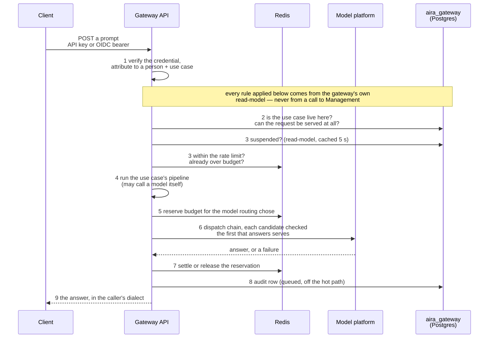

In words, and the order is the point:

1. **Who is this?** An API key is looked up by its prefix and compared against a stored hash; an
   OIDC token is verified against the realm's public keys. Either way the result is one
   attribution: a person, a credential, a use case. Nothing else in the request is trusted. A
   caller turned away here — no valid credential, a use case it may not use — writes no audit row;
   its trace is its record (§8.8).
2. **Does this gateway serve that use case, and can the request be served at all?** A use case is
   served only while the gateway holds its record from Management and the record is not retired, so
   one created a moment ago serves once its event has arrived. A request that can never succeed —
   empty, too many attachments, a sampling value outside every dialect's range, tools or reasoning
   its use case has not switched on — is refused here, before it spends an allowance.
3. **Is this caller allowed to work at all?** Suspensions, then the rate limit, then "already over
   budget" — *before* the pipeline, because a refused caller must not pay for a classifier call
   first.
4. **The use case's own rules run.** The pipeline may inspect the prompt for injection, route the
   request to a different model, or rewrite text it must not forward. Each step's verdict is
   recorded, and a step that cannot decide blocks by default.
5. **Budget is reserved against the model routing chose**, not the one the caller typed, once the
   catalogue has accepted that model for the request (it generates, and the output cap fits). The
   reservation makes requests in flight visible to each other's check: a counter they have filled
   refuses the next request. Only a counter already at its limit refuses, so a request larger than
   what is left is admitted, and a period can end above its limit.
6. **The call goes out, through a chain.** The catalogue says who hosts each candidate and what it
   can do. A candidate that cannot honour the request — not released to the use case, unpriced where
   spend is capped, no tools, no document reading, wrong region — is skipped **by name**, never sent
   a silently reduced request. A use case may name further models to try, and that chain applies to
   a streamed answer as well, for as long as nothing has reached the caller; each pipeline step has
   its own chain for the model it asks. The candidate is addressed in its vendor's own wire format,
   which only `upstreams/` knows.
7. **The reservation is settled** against what was actually used, or released if nothing ran.
8. **One audit row is written** — for every request that was attributed, including the ones refused
   after that point and the ones whose caller hung up mid-answer; each model call a pipeline step
   made has a row of its own. The one exception is a defect before dispatch: a `500`, logged as
   `unhandled_error`. Rows go through a bounded queue to a background writer, so persistence stays
   off the request path until the queue is full — then the row is written inline, by the request
   that produced it, rather than dropped.
9. **The answer is rendered** in whichever dialect the caller used.

Typical cost of all of this, measured: **48 ms of gateway CPU** for a chat request, **93 ms** for
an agentic one, against a model that takes seconds ([`DEPLOYMENT.md`](DEPLOYMENT.md) §1a).

### Loop 2 — changing the configuration

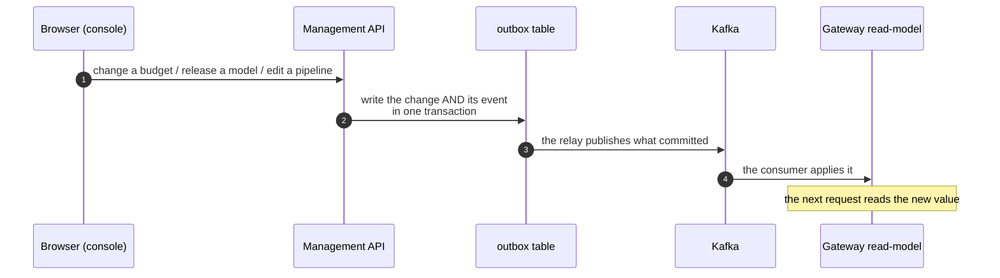

Why not a call from the gateway to Management? Because the data plane must be able to answer
without asking anybody. So Management **owns** configuration and the gateway keeps a local
**read-model** of it, fed by events on compacted Kafka topics. The gateway never calls Management
on the request path — not for a price, not for a capability, not for a rule. The cost of that
choice is honest and stated: a change is effective **after** the relay and the consumer have run,
not the instant it is saved. The relay is a job that publishes what is pending and exits, so the
delay is whatever schedule runs it — every ten seconds in the Compose stack — plus the consumer,
plus the gateway's caches of grants, roles, rate limits and suspensions, five seconds each.

The event is written in the same database transaction as the change it describes, so no event
exists for a change that rolled back and none is lost for one that committed. While Kafka is
unreachable, changes wait in the outbox and the gateway serves on the read-model it holds; neither
plane leaves rotation over it (§6).

**One deliberate exception.** The incident kill switch is written straight to the gateway. A
control that depends on the event bus fails exactly when the bus is the problem.

### What falls out of those two loops

- **Everything is attributed or refused.** There is no anonymous path to a model.
- **Evidence and enforcement read the same rows.** Anomaly detection runs over the audit trail and
  nothing else, so "the alert says X but the report says Y" is unreachable — and it sees every
  refusal made after attribution, where much of the signal is.
- **Under load nothing is rejected; it queues.** An instance past its capacity looks like a slow
  model from outside. Sizing is therefore a decision somebody has to make, not something the system
  makes for them.

### What it deliberately is not

Auditable model access, **not agents**: no retrieval, no conversation state, no tool *execution* —
tool calls are carried between client and model, never run here — and no workflow orchestration.
Each of those would put the gateway in the position of deciding something it could not then audit.

---

## 2. C4 Level 1 — System context

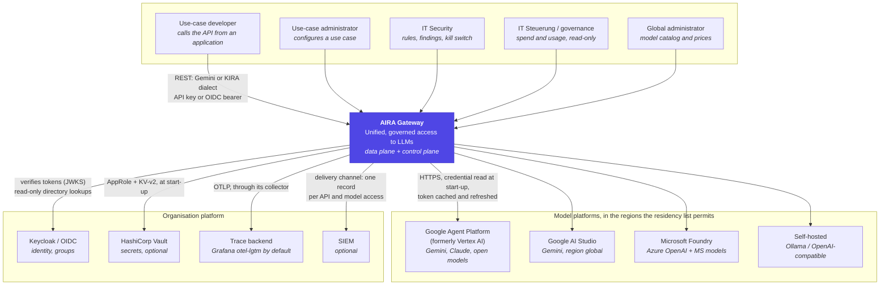

**Four platform families**, each one transport in `upstreams/` (§4): Google's Agent Platform —
Gemini, Claude, and managed open models such as GLM and DeepSeek; Google AI Studio, whose endpoint
names no region and so counts as `global`; Microsoft Foundry; and any server that speaks the OpenAI
format. Where a request may be processed is one installation-wide list, `AIRA_ALLOWED_REGIONS` — EU
regions unless configured otherwise — checked at start-up against every region the configuration
declares and again per request. Every cloud model has one (a Foundry deployment that names none
stops the start); a self-hosted server has one only if the operator names it. A region outside the
list can be permitted for **named models only** (`AIRA_ALLOWED_MODEL_REGIONS`): that is how the
open models, which answer only at `global`, are used without `global` being permitted for every
model.

**Telemetry leaves through one collector** in the stack: a fixed core plus configuration fragments
for each destination. It feeds two channels — the trace backend, and an optional **delivery
channel** that forwards a filtered record of every API access and every model access to a SIEM.
That record includes the refusals the audit trail does not hold (§8.8). Which traces are kept is
decided by the installation's sampling ratio, never by the caller: a ratio below 1 thins the
delivery channel too, because its records are spans.
[`INTEGRATIONS.md`](INTEGRATIONS.md) §6 has both channels.

**The three organisation-wide roles** are conferred by **group membership** and by nothing else;
both planes resolve the same `groups` claim through `AIRA_ROLE_GROUPS`, and a realm role assigned
directly grants nothing. Questions that must not answer for one another are separate permissions
(`aira_common.permissions`), and every check asks one of them — never a role name:

| Question | Permission | Held by default |
|---|---|---|
| may **see** every use case | `usecase.read_all` | global-admin, it-security, it-steuerung |
| may see every **figure** | `report.read_all` | global-admin, it-security, it-steuerung |
| may **act** in an incident | `incident.suspend` | global-admin, it-security |
| may **administer** every use case in the console | `usecase.manage_all` | global-admin |

Asking the wrong one grants or withholds the wrong thing. Guarded by *may see every use case*, the
kill switch would let IT Steuerung — which by default sees every use case and every figure and
changes nothing — stop traffic. Guarded by *may see every figure*, the use-case list would be empty
for a role that may see every use case but not every figure. `usecase.manage_all` is a
control-plane permission: by itself it opens nothing in the gateway, where calling a use case or
reading its requests still takes a grant on it, or a permission of its own.

---

## 3. C4 Level 2 — Containers

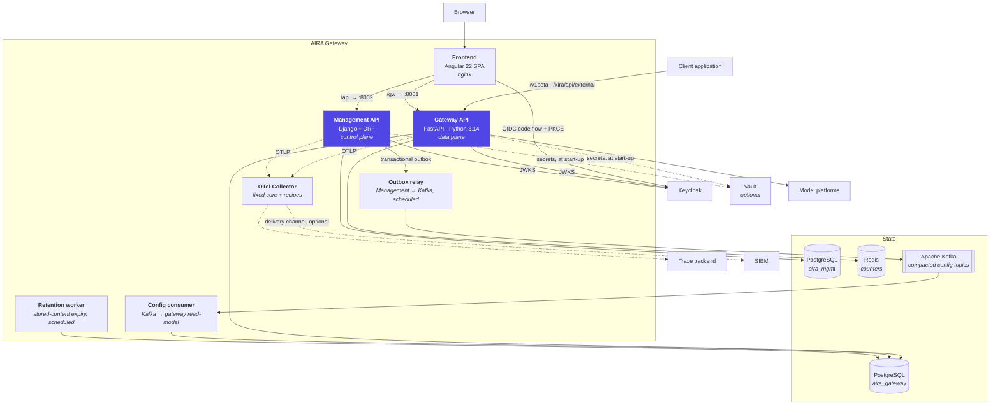

### Why two planes, and why they talk over Kafka

The data plane must answer a request without asking anybody. So Management **owns** configuration
and the gateway keeps a **read-model** of it: use cases, memberships and group grants, API keys,
pipelines, budgets, rate limits, the model catalog, anomaly rules and roles all arrive as events on
nine compacted topics. The gateway never calls Management on the request path — not for a price,
not for a capability, not for a rule.

The event flow is a **transactional outbox**: `emit()` runs inside the same database transaction as
the change it describes, so an event is never published for a change that rolled back and never
lost for one that committed.

**An event is JSON with an `event_type` header** — no version field and no registered schema.
Management builds each payload and the gateway's consumer reads it, and a set of cross-plane tests in
`tools/tests` (`test_the_two_planes_agree_on_the_event_vocabulary.py` among them) is what keeps the
two in step. Every topic and event, with its fields: [`API.md`](API.md) §4. The Compose stack also runs
a `schema-registry` container that no AIRA code uses.

**The bus is a trust boundary**: the gateway builds who may do what — keys, grants, roles — from
whatever arrives on it. So outside `local` both planes refuse to start while the broker is reached
over `PLAINTEXT` (the gateway waives this in a declared demo), and authenticate to it with SASL, TLS
or both. Where several stages share one cluster, every topic and the gateway's consumer group carry
the stage's name (`aira.<stage>.usecases`, `AIRA_KAFKA_STAGE`), so a stage's credentials can be
limited to its own topics.

**One exception, deliberate**: the incident kill switch is written straight to the gateway. A
control that depends on the event bus fails exactly when the bus is the problem.

### The containers, precisely

| Container | Image / entry point | Port (container) | What it is |
|---|---|---|---|
| `gateway` | `aira-gateway` · `uvicorn` | 8001 | The API clients call, and the anomaly evaluator |
| `gateway-consumer` | same image · `python -m aira_gateway.consumer.worker` | — | Applies config events to the read-model |
| `gateway-retention` | same image · `python -m aira_gateway.retention` | — | Clears expired stored content; one pass, then exits |
| `management` | `aira-management` · Django | 8002 | Control-plane REST API |
| `management-relay` | same image · `manage.py relay` | — | Publishes the pending outbox to Kafka; one pass, then exits |
| `frontend` | `aira-frontend` · nginx | 8080 (published on 4200) | The SPA, plus `/api` and `/gw` proxies |

The two one-pass jobs are scheduled from outside: the Compose stack wraps each in a shell loop
(the relay every 10 seconds, retention hourly), and a deployment runs them from cron, a systemd
timer or a CronJob ([`DEPLOYMENT.md`](DEPLOYMENT.md) §6). Migrations and topic creation run as
one-shot containers before the long-lived ones (`gateway-migrate`, `management-migrate`,
`kafka-topics`). Running the stack, from a laptop to your own infrastructure:
[`deployment/`](deployment/README.md).

---

## 3a. What belongs to what — the repository, mapped

Every box in the diagrams above is code in this repository. This is the map from one to the other,
so that a reader can start at a concern and arrive at a file.

### Top level

| Path | Runs as | What lives here |
|---|---|---|
| `gateway/` | `gateway`, `gateway-consumer`, `gateway-retention` | The **data plane**: the API clients call, plus its two workers. **One image**, five entry points — the HTTP service, the config consumer, the retention pruner, the operator CLI (`python -m aira_gateway.cli`) and `alembic upgrade head`. |
| `management/backend/` | `management`, `management-relay` | The **control plane**: the REST API the console talks to, and the process that publishes its outbox. Same image runs `manage.py migrate` and the demo seed. |
| `management/frontend/` | `frontend` | The Angular console, served by nginx, which also proxies `/api` to Management and `/gw` to the gateway. |
| `libs/` | imported by both | `aira_common` — what both planes must agree about: the money type, the API-key format, the access rules and the permission catalogue, the capability vocabulary, OIDC verification, the directory, Vault and Redis clients, telemetry, and the Kafka topic names, `event_type` header, size bound and encoder. Not the event payloads: those are built in Management and read by the gateway's consumer, kept in step by tests (§3). **A rule that exists in both planes lives here or it drifts.** |
| `deploy/compose/` | — | **Three files that combine** into the stack — infrastructure, the applications, the demo provisioning (with a Samba AD domain controller for the Windows sign-on demo, profile `windows-sso`) — and three overlays layered on with an extra `-f`: `release` takes the published images instead of building them, `external` runs the applications against infrastructure you provide, and `loadtest` adds the load harness's model double. Which composition is which: `tools/compose_files.py`. See [`deployment/`](deployment/README.md). |
| `tools/` | developer commands | Seeding, diagnostics, the mutation harness, the load harness, the repository's own guard tests (`tools/tests/`), and the OpenCode plugin the console hands to developers (`tools/opencode/`). |
| `tests/integration/`, `e2e/` | opt-in test tiers | Against a live stack, and against a real browser. See [`TESTING.md`](TESTING.md). |
| `docs/` | — | This document and the other reader documents (§9), and the development record behind them, which [`CONTRIBUTING.md`](../CONTRIBUTING.md) lists. |

### Inside the gateway — `gateway/src/aira_gateway/`

Read it in the order a request travels.

| Path | What it is for |
|---|---|
| `main.py`, `app.py`, `state.py`, `config.py` | Wiring and settings: build the application, start the background work, hand the components to the request path. `config.py` holds `GatewaySettings`, one field per `AIRA_*` variable, the ones both planes share inherited from `aira_common.config`. |
| `middleware.py`, `cors.py`, `exception_handlers.py`, `security.py` | What runs outside any route: trace id, security headers, the body-size ceiling, the use-case path, and the startup refusal when a production deployment is configured like a laptop. |
| `auth/` | Turning a credential into an attribution: API keys, OIDC, group grants, roles, and the failed-attempt bound. |
| `api/gemini/`, `api/kira/` | The two **surfaces**. They parse a wire format and render an answer, and do nothing else. KIRA is the transitional one: every answer carries `Deprecation: true`, and `AIRA_KIRA_SUNSET` sets a `Sunset` date. |
| `api/serving/` | **The order.** `prepare.py` owns the pre-dispatch sequence, `accounting.py` owns every exit — served, refused, or abandoned. A surface calls these; it never assembles the steps itself. |
| `api/usage.py`, `api/pipeline.py`, `api/providers.py` | Around the surfaces: a use case's consumption for the console, and **the caller's own allowance** (`GET /v1beta/me/budget`) — what the OpenCode plugin the console hands out shows inside a developer's editor; trying a pipeline (`pipeline:dryRun`); what each platform offers for import. |
| `pipeline/` | The per-use-case steps and the chains: `engine/` runs the configured steps (each with its own chain of models to ask), `classifiers/` are the steps themselves (injection, routing, redaction), `dispatch.py` picks a model that can actually serve the request — a finished answer or a stream, through one candidate walk. |
| `catalog.py`, `requirements.py`, `residency.py`, `thinking.py`, `embedding.py`, `attachments.py` | What a model may be asked for, and what it must be able to do to be asked. One question per module. |
| `ratelimit/`, `budgets/`, `scopes.py`, `pricing.py` | How fast and how much. `scopes.py` holds the scoping rule once — and the order the scopes apply in: the use case's pot over everybody, a person's own budget in place of the one for everybody — because budgets and limits scope identically. |
| `upstreams/` | **Where the vendors live.** One package or module per platform — `vertex/` (Gemini, Claude and the open models), `gemini.py` (AI Studio), `foundry/`, `openai/` — each split into a transport (how to reach it) and a dialect (what the wire looks like); `mock.py` is the offline double. An architecture test fails when one of the platform-specific names it lists — `anthropic`, `claude`, `azure`, the open models' publishers and endpoints, among others — appears in code outside `upstreams/vertex/`, `upstreams/foundry/` and the region list in `residency.py`. |
| `core/canonical.py`, `core/schema.py` | The provider-agnostic request and answer everything above `upstreams/` speaks. |
| `persistence/` | The audit trail: `writer.py` (a bounded queue off the request path; a full queue writes inline rather than drop a row), `redaction.py` (credential shapes in stored content), `sanitize.py`. |
| `audit.py`, `audio.py`, `payloads.py`, `shielding.py` | What is recorded — spoken audio as a description, never the audio — who may read stored content, every read being recorded in turn, and the exit work a dropped connection must not cancel. |
| `anomalies/` | Detection over the audit rows, and the suspensions it produces. |
| `reporting/`, `api/reporting/` | Spend and usage, the series behind the usage chart, the register of processing activities (`register.py`), their CSV export, the request list and the findings. |
| `api/incidents/` | The kill switch (suspensions), the two model checks (`:check`, `:checkThinking`) and the log of who read stored content. |
| `consumer/` | The second process (`worker.py`): applies configuration events into the read-model (`apply.py`). |
| `retention.py` | The third process: clears stored content past each use case's period, deletes whole rows past `AIRA_LOG_RETENTION_DAYS` (off by default, so rows are kept), and records each pass in `retention_runs`. |
| `db/` | The read-model and the audit tables as ORM models. Their **schema** is owned by `gateway/migrations/` (Alembic), a sibling of `src/`, never by the models. |
| `telemetry.py`, `diagnostics.py`, `routes/health.py` | Traces and metrics, upstream probing, `/healthz`, `/readyz` and `/version-info`. |
| `cli.py` | Operator commands: minting and revoking the break-glass key. |

### Inside Management — `management/backend/src/aira_management/`

| Path | What it is for |
|---|---|
| `apps/usecases/` | The centre of the control plane. `access.py` holds `may_admin`, `may_manage`, `is_member` — **one** definition, enforced by the viewsets *and* reported to the console so it cannot offer what the server refuses. |
| `apps/apikeys/`, `apps/pipelines/`, `apps/budgets/`, `apps/ratelimits/`, `apps/anomalies/`, `apps/catalog/` | One app per configurable object, each mirroring a section of §1a's table. |
| `apps/roles/` | The roles an installation stores — IT Steuerung's permission set and any role it adds, each held through one Keycloak group — with their change log (`RoleChange`, before and after) and the check that a group exists before a role is bound to it. |
| `apps/outbox/` | The transactional outbox and the relay that publishes it. |
| `apps/directory/` | The only thing AIRA asks Keycloak beyond signing keys: looking up people and groups so an administrator can pick them. |
| `apps/privacy/` | The generated privacy notice, and the register of every stored column that the test suite checks the schema against. |
| `apps/api/` | Authentication, error envelopes, routing — the plumbing every app shares. |
| `apps/seed/`, `apps/smoketests/`, `apps/health/` | Demo data, the question catalogue put to a use case (the *Pipeline tests* screen), readiness. |
| `rbac.py`, `roles.py` | Roles from Keycloak groups and the permissions they hold, and object permissions through `django-guardian`; `roles.py` re-exports the built-in role names from `aira_common`. |

### Inside the console — `management/frontend/src/app/`

| Path | What it is for |
|---|---|
| `features/use-cases/` | The page most work happens on: a parent that loads and owns the tab bar, and one child per tab owning its own form state. |
| `features/pipelines/`, `features/models/`, `features/governance/`, `features/reporting/`, `features/security/`, `features/requests/`, `features/privacy/`, `features/platform/`, `features/smoketests/` | One folder per screen, each reading whichever plane owns its data. |
| `core/api/` | Typed clients for both planes, and `error-message.ts` — every load and mutation reports its outcome through it, so there are no silent failures. |
| `core/auth/` | The OIDC code flow with PKCE; the console holds no long-lived credential. |
| `core/ui/` | The primitives shared rather than rewritten per page — each because the second copy went wrong: `live.ts` (polling that stops, is visible and never stacks), `info-hint` (the explanation beside a figure), and `table-view`/`table-pager` with their server- and cursor-paged siblings. |

### Where to start reading

| If you want to understand… | Start at |
|---|---|
| what one request does | `api/serving/prepare.py`, then `accounting.py` |
| how a vendor is added | `upstreams/openai/` — the smallest complete example of transport × dialect |
| what a use case may do | `libs/src/aira_common/access.py` and `apps/usecases/access.py` |
| how configuration travels | `apps/outbox/`, then `gateway/src/aira_gateway/consumer/apply.py` |
| what is recorded | `gateway/src/aira_gateway/audit.py`, then `persistence/writer.py` |

---

## 4. C4 Level 3 — Inside the Gateway API

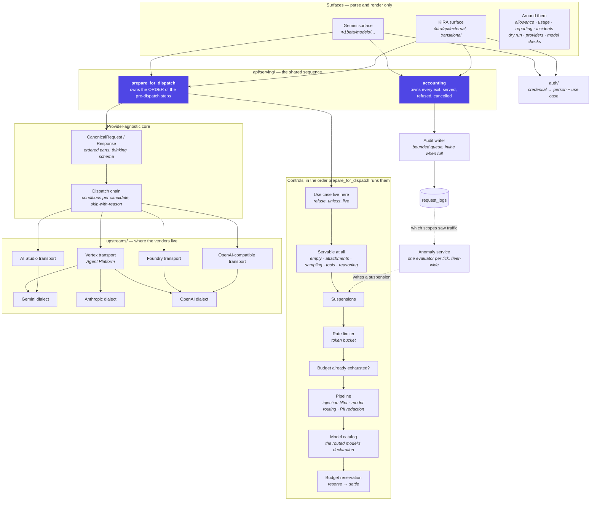

### The three structural rules

**A surface parses; the layer decides.** Both API dialects call `prepare_for_dispatch` and
`accounting` rather than assembling the steps themselves. Every guarantee that layer makes is a
guarantee about the *order* — rate limit before the pipeline, declaration after routing, reservation
last — and an order cannot be shared by sharing the steps. A test (`test_surface_layering.py`)
fails on a surface that calls a step directly.

**Transport × dialect × model identity.** A transport owns reaching a cloud (endpoint, credential,
region); a dialect owns the wire shape; the caller's model name is never the platform's addressing.
An architecture assertion parses the gateway's code and fails when one of the platform-specific
names it lists appears outside the two platform packages that own them and the region list; a
wire format several platforms speak, such as `openai`, is not a vendor name and is not on it.

**Hide the plumbing, declare the semantics.** Capability flags say *whether*, never *how*, and
**undeclared means unsupported**. A difference that changes the *answer* is never hidden: a model
that cannot read the attachment is skipped by name, not sent the prompt without it.

---

## 5. C4 Level 3 — Inside the Management API

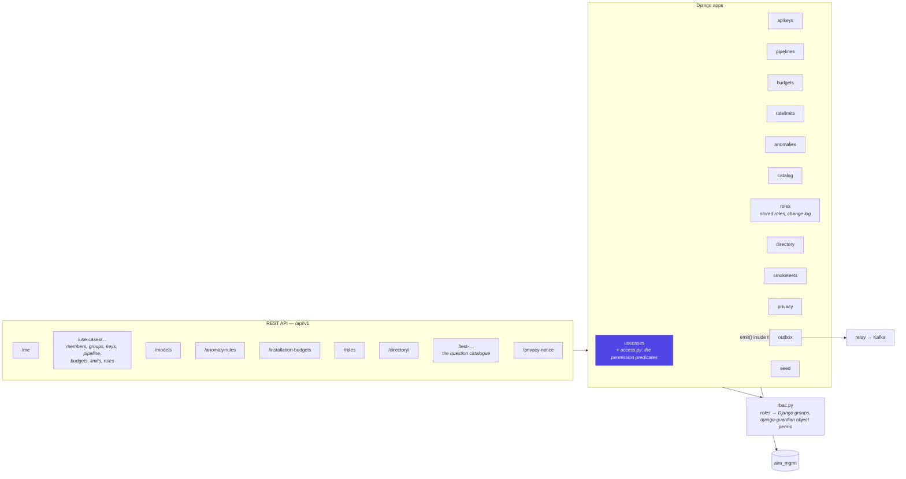

Every route of both planes, and who may call it: [`API.md`](API.md).

**One definition of who may do what.** `apps/usecases/access.py` holds `may_admin`, `may_manage`
and `is_member`; the viewsets enforce with them *and* the serializer reports them to the console, so
the console cannot offer an action the server refuses. An agreement test attempts each request and
requires the status to match what the object reported.

**Who reaches a use case, and how the two planes agree about it.** A grant binds a **principal** —
a Keycloak group or a person — to a use case with a role. A group grant assigns the object
permissions to a Django group mirroring the Keycloak path, and every authenticated request syncs the
caller's group paths onto their Django groups, so `django-guardian` answers user-and-group
permissions in one query and the predicates above serve both kinds of grant. The gateway resolves
the same question from the token's `groups` claim and its username against read-model tables fed
over Kafka, with the `/use-cases/<slug>` convention still resolving membership from the token alone
(serving still needs the use case's own record, §1a). The routes are a **union** and the stronger
role wins; both rules live once, in `aira_common.access`.

**The SPA's screens**, and which plane each reads:

- the use-case list and each use case's page (management), whose tabs are *Overview*, *Members*,
  *API keys*, *Budgets* and *Rate limits* (consumption from the gateway), *Rules*, and the
  gateway's *Warnings* and *Requests*;
- the pipeline builder (management; its dry run is the gateway's);
- models and prices (management), beside what the gateway serves, what each platform offers for
  import, and the two model checks (gateway);
- reporting and its CSV export (gateway), with the **installation's own budget** on that same
  screen, because the figure it bounds is already there as the `(none)` row of *By use case*;
- the installation-wide *Requests* list and the *Register* of processing activities (gateway);
- *Pipeline tests*, the question catalogue (management; each question goes to the gateway as an
  ordinary request);
- the **Security console**: findings and suspensions (gateway), installation-wide rules
  (management);
- *Platform*: roles and their change log (management), and who read which stored content (gateway);
- the privacy notice (management).

The Security console and the per-use-case *Warnings* and *Requests* refresh themselves through one
primitive, `core/ui/live.ts`: it polls, it stops on destroy and while the tab is hidden, it never
stacks a request behind a slow one, and it shows the reader how stale the view is with a switch to
turn it off.

Three primitives are shared across those screens rather than written per page, each because the
second copy went wrong: `core/ui/live.ts` (polling that stops, is visible and never stacks),
`core/ui/info-hint` (the hover/focus/pin explanation beside a figure or a control) and
`core/ui/table-view` + `table-pager` (search and paging, client-side, for lists that arrive in one
response).

---

## 6. Data stores, and what each is for

| Store | Holds | Why this one |
|---|---|---|
| `aira_mgmt` (Postgres) | use cases, memberships and group grants, keys (hashed), pipelines, budgets, limits, rules, catalog, stored roles and their change log, privacy-notice acknowledgements, the identities of people who signed in or were invited, the question catalogue's runs and the models' answers to it, outbox | System of record for **configuration** |
| `aira_gateway` (Postgres) | read-model of the configuration (use cases, members, group grants, keys, pipelines, budgets, limits, rules, catalog, roles), plus `request_logs`, `payload_access` (every read of stored content), `anomaly_events`, `access_suspensions`, `budget_usage`, `retention_runs`, and keys minted on its command line | System of record for **what happened**; the gateway cannot serve without it |
| Redis | rate-limit buckets, budget reservations | Shared counters across replicas; written on **every** request. Reached directly, or through Redis Sentinel so the leader can move |
| Kafka | nine compacted config topics | Ordered, replayable configuration distribution |
| Vault | credentials, when configured | Read once at start-up as a **settings source**, never injected into `os.environ`; without `VAULT_ADDR` every secret comes from the environment |

The audit trail is kept **indefinitely by default**: the retention worker clears stored prompts and
answers after each use case's period (default 7 days) and keeps the rows, unless
`AIRA_LOG_RETENTION_DAYS` is set.

**Degradation is decided, not accidental.** Without Redis, rate limits fall back to a per-instance
bucket (bounding, not fail-open) and budgets to the Postgres path (enforcing but racy); `/readyz`
answers 200 with `degraded: true`, and the degradation is frozen onto each audit row so a request
can be read in the light of the conditions it met. **Postgres alone decides readiness, on both
planes.** Kafka is reported (`required: false`) and, when no broker answers, only sets `degraded`:
the gateway serves on the read-model it holds and Management's changes wait in its outbox, so a bus
outage costs configuration changes, not traffic. A cluster counts as reachable while any broker
answers.

---

## 7. Where the money and the evidence live

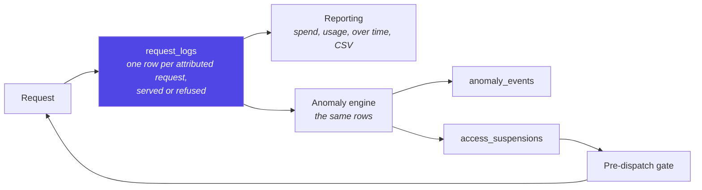

Detection reads **the audit trail and nothing else**. Two consequences, both wanted: a detector
cannot see anything the report cannot, so "the alert says X but the report says Y" is unreachable —
and it sees *refusals* made after attribution, which is where much of the signal is.

Money is **integer nano-units, never a float**, and crosses APIs as decimal strings. Unpriced
traffic is counted apart, never as zero — and a request refused before dispatch is neither: nothing
ran, so its cost is a genuine zero rather than an unknown. **Where a cost limit binds, an unpriced
model is refused** (`AIRA_ENFORCE_PRICED_MODELS`, on by default): unknown spend cannot be counted
against a cost budget, so it would spend without bound. As a candidate of a chain it is skipped by
name and a priced one serves; a request with no priced candidate is refused with the reason.

---

## 8. Authentication — who proves what, to whom

**In short.** Every person and every application that reaches AIRA has to prove who it is, and
everything AIRA records or refuses afterwards hangs off that proof. People prove it with a login at
the organisation's own identity provider (Keycloak); applications prove it with an API key AIRA
issued for one use case. AIRA checks both itself, on the spot, without asking Keycloak on each
request: a person's token is verified against the realm's public signing keys, and a key against a
hash in the database. What a caller may then *do* never comes from the token — the token says who
they are and which groups they are in, and AIRA decides from its own configuration what those
groups are allowed to do. There is no third way in: no local password, no shared admin account, and
no API key that reaches the control plane.

### 8.1 The three kinds of caller

Keycloak issues every token, and AIRA verifies each one itself against the realm's public signing
keys. **No request is answered by asking Keycloak whether a caller is valid**; the keys are cached
for minutes at a time and fetched again when that cache lapses, or when a token names a signing key
AIRA has not seen yet — which is what makes a key rotation heal itself. The only
other calls to Keycloak are Management's read-only directory lookups, used while somebody is
granting access in the console.

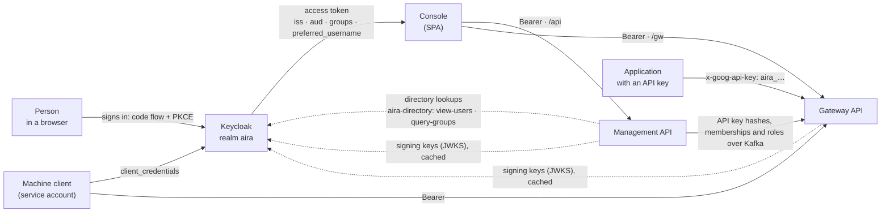

Three kinds of caller, and nothing else reaches either service:

1. **A person in the console.** They sign in at Keycloak; the console holds the resulting token and
   sends it to both APIs.
2. **An application with an API key.** It calls the gateway only, and only inside the one use case
   the key was issued for.
3. **A machine client of the organisation** (a Keycloak service account, for a scheduled job or
   another system). It fetches a token from Keycloak with its own client credentials and is then
   treated like a person: the same verification, the same groups, the same rules.

### 8.2 A person signing in

The console is a browser application with no secret of its own, so it uses the authorization-code
flow with PKCE — the flow designed for exactly that situation.

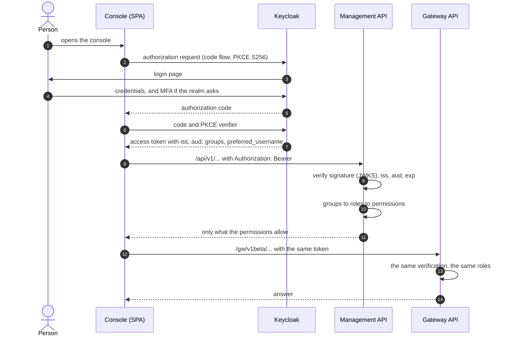

In words, for a reader who cannot see the diagram:

1. The person opens the console. Finding no valid token, it sends them to Keycloak, remembering a
   one-time secret (the PKCE verifier) that never leaves the browser.
2. Keycloak shows its own login page and applies whatever the organisation requires there —
   password, MFA, a hardware token — or, at a PC of a Windows domain, accepts the Kerberos ticket
   the browser presents and shows no page at all ([`INTEGRATIONS.md`](INTEGRATIONS.md) §2).
   **AIRA never sees any of it**, and gets the same token either way.
3. Keycloak sends the browser back with a short-lived authorization code.
4. The console exchanges that code, together with the PKCE verifier, for an access token. Without
   the verifier the code is worthless, which is what makes it safe for an application that cannot
   keep a secret.
5. The console calls the Management API and the Gateway API with the same token in an
   `Authorization: Bearer …` header. Each service verifies it independently — neither trusts the
   other, and neither trusts the console.
6. The token is kept in the browser tab's session storage and is gone when the tab closes. The
   console sets no cookies of its own and holds no long-lived offline token: when the session at
   Keycloak ends, access to AIRA ends with it.

### 8.3 What both services check on a token

Every request carrying a token is checked against four things, in the service itself:

| Checked | Why it matters |
|---|---|
| **Signature**, against the realm's published keys (JWKS) | Proves the token was issued by that realm and has not been altered. The keys are cached, so this costs no call to Keycloak on a normal request. |
| **`iss` (issuer)**, compared literally with the configured address | Keycloak writes `iss` from the address the token was requested through. Comparing literally means a token obtained through some other address — a second hostname, a proxy nobody expected — is refused instead of quietly accepted. |
| **`aud` (audience)** | Says which client the token was minted for. Without it, *any* token from the realm would be accepted, including one issued to an unrelated application. A deployment outside local development refuses to start without an audience configured — Management always, the gateway unless it is a declared demo. |
| **`exp` (expiry)**, with a small tolerance for clock drift | A token is only valid for minutes. The tolerance (default: 60 seconds for a clock running ahead, none past expiry) exists because two servers are never perfectly in step, and a one-second difference would otherwise refuse every freshly issued token. |

Two details worth knowing:

- **The gateway can trust more than one realm.** An organisation that is mid-migration, or that has
  merged, can configure several issuers; a token is routed by its own `iss` to the realm it names
  and then verified properly against that realm. Each realm brings its own audience and keys. The
  Management API trusts exactly one realm.
- **Verification costs no round trip.** The only network call is fetching the signing keys, and that
  answer is cached and shared by every request.

### 8.4 From groups to permissions — why roles are not in the token

A token says which **groups** a person is in. It does not say what they may do in AIRA, and that is
deliberate:

- **One source of truth for membership.** Adding somebody to a use case, or to IT Security, is done
  once in the identity provider — where joiners and leavers are already handled — instead of in a
  second place that has to be kept in step.
- **Access can be changed without touching the identity provider.** What a role is *allowed to do*
  is AIRA's own configuration; an installation can create its own roles and change their
  permissions without asking anybody to edit the realm.
- **A change in AIRA does not wait for tokens to expire.** What a role may do and what a grant
  reaches are read per request from AIRA's own data, so a change applies once it has reached the
  gateway — after the relay and the consumer, and the five-second caches (§1a) — rather than when
  the person's token happens to expire. The groups themselves come from the token: somebody removed
  from a group in Keycloak keeps what it conferred until their token expires (minutes), and an API
  key they own is not ended by it ([`INTEGRATIONS.md`](INTEGRATIONS.md) §2).

Concretely, and **in two layers that are deliberately not the same mechanism**:

- **Installation-wide.** Configuration maps a group path to a role (`/aira/it-security` → IT
  Security); each role holds a set of named permissions; a caller's permissions are the union over
  every role whose group their token carries. Two roles are fixed in code and never read from a
  table, so a broken role row cannot lock everybody out: `global-admin` holds every permission by
  construction and `it-security` a fixed set. `it-steuerung` and any role an installation adds are
  data (`aira_common/permissions.py`). A group path is matched **exactly and never as a prefix**, so
  `/aira/global-admins-readonly` cannot confer what `/aira/global-admins` does.
- **Inside one use case.** A **grant** binds a principal — a Keycloak group path, or one named
  person — to that use case as `user` or `admin` (`aira_common/access.py`). `user` may call the
  gateway attributed to it and read its figures; `admin` may additionally change its members, keys,
  pipeline, budgets and limits. Several routes may reach the same person, and the **strongest role
  wins** rather than the one whose row happens to be read first. The `/use-cases/<slug>` convention
  still resolves membership from the token alone, as one route among several, and needs no grant —
  which is why the demo realm uses it. Serving does need the use case's record: a request to a use
  case the gateway holds no record of, or holds retired, is refused, so a `/use-cases/<slug>` group
  naming a use case Management does not have confers nothing that works.

Management owns both and publishes them to the gateway over Kafka (`aira.roles`,
`aira.memberships`), so both planes answer the same question the same way. A realm role assigned
directly in Keycloak grants nothing in AIRA — only group membership does.

### 8.5 An application with an API key

A key exists so that an application can call the gateway with nobody sitting in front of it, while
every request still belongs to a named person and one use case.

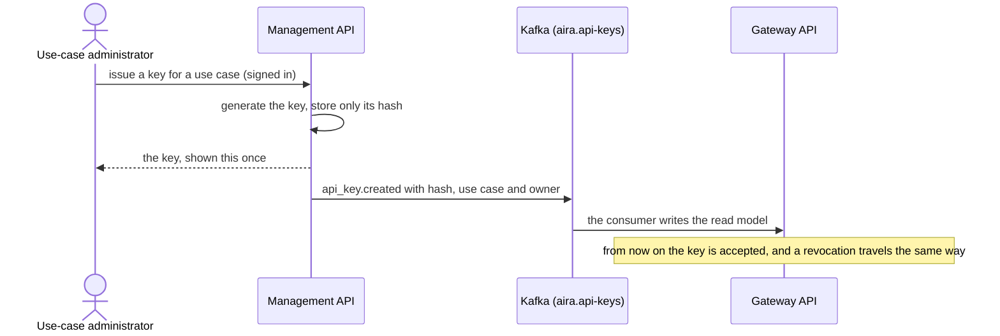

What that means in practice:

- **The key is shown once.** AIRA stores only a SHA-256 hash of it, plus the short, non-secret
  prefix used to find the row. A lost key cannot be recovered, only replaced — and a copy of the
  database does not contain any usable key.
- **A key belongs to one use case and one owner.** Every request made with it is recorded under that
  person's name, which is why issuing a key for a colleague is a deliberate, recorded act.
- **A key expires.** 30 days by default, at most 180 (both configurable). Neither the console nor
  the command line offers a key without an end date, because a credential that never expires is one
  somebody has to remember to take away. Two kinds carry none: a key issued before keys had an end
  date, and the demo key, whose plaintext is published and which works only in a declared demo.
- **Revocation and issuance travel the same way**, over Kafka, and take effect once the relay has
  run and the consumer applied them — seconds in the Compose stack, where the relay runs every ten;
  elsewhere, whatever schedule runs the relay.
- **The control plane accepts no keys at all.** A key reaches the gateway and nothing else, so a
  leaked key can spend budget but cannot change configuration, read the roles or grant access.

### 8.6 A request to the gateway, step by step

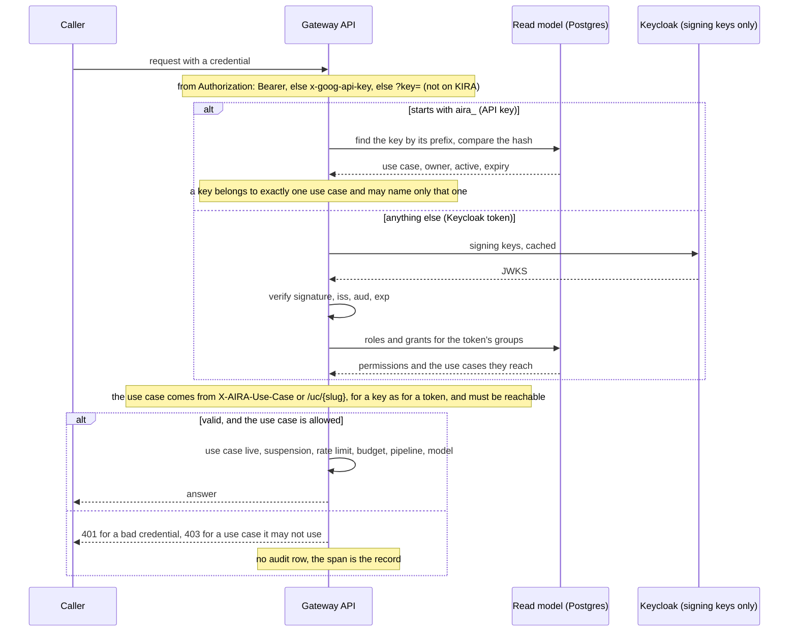

1. **Find the credential.** `Authorization: Bearer …` first, then the `x-goog-api-key` header, then
   `?key=`. The last two exist so that clients written for Google's Gemini API work against AIRA
   unchanged — and the URL is read on the Gemini surface only: a key there lands in every proxy's
   log, and the KIRA surface's clients send theirs in a header, so that surface refuses a key in
   its URL by name.
2. **Decide what it is by its shape.** A credential beginning with `aira_` is an API key; anything
   else is treated as a token. Nothing else distinguishes them, and no caller can choose the path.
3. **Check it.** A key is looked up by its prefix and its hash compared in constant time; the row
   also says whether it is still active and not expired. A token goes through the four checks
   in §8.3.
4. **Decide which use case the request belongs to.** The `X-AIRA-Use-Case` header wins; otherwise a
   `/uc/<slug>` path segment. **A model call names one, whatever the credential**: a key issued by
   Management belongs to one use case and may name only that one, and a person names one of those
   their grants reach — on both surfaces, also the KIRA surface, whose contract has no field for a
   use case of its own. A call that names none is refused, and the refusal says which to name: the
   key's own use case, or the ones the person reaches. **A selector never grants access — it only
   chooses among what the caller already has.** Naming a use case the caller is not in is refused.
5. **Then the governed part of the request begins** — whether that caller is currently stopped,
   rate limits, budgets, the use case's pipeline, and which model it may use. That is
   [`REQUEST-LIFECYCLE.md`](REQUEST-LIFECYCLE.md).

A read-only call (`GET`, `HEAD`, `OPTIONS`) needs no use case: listing what is configured spends
nothing, and an administrator who is a member of no use case must still be able to read the
catalogue. A key's reading is its own use case's, so a client that asks what is left of its budget
before it names anything is still answered.

**What is refused, and with which answer** — none of these writes an audit row, because the request
was never attributed; its span is the record (§8.8):

| Answer | When |
|---|---|
| `401` | No credential, or one that does not verify: bad signature, wrong issuer or audience, expired, unknown or revoked key. The answer never says which — that would tell a prober how close they are. |
| `403` | A valid credential asking for a use case it may not use: not a member, or a key bound to another use case. On the KIRA surface also: no use case named, which that surface's vocabulary answers as a permission refusal. |
| `400` | A use case named in a form that is not a valid identifier, or — on the Gemini surface — none named. |
| `429` | Too many **refused** authentication attempts from one source address (default 60 a minute, on both planes). Successful requests never touch that counter, so an ordinary integration cannot trip it, however busy. `Retry-After` says when to come back. |

### 8.7 Directory lookups — the one thing AIRA asks Keycloak

When somebody grants access in the console, they need to find a colleague or a group that may never
have signed in to AIRA. That is the only case in which AIRA queries Keycloak's admin API, with a
dedicated read-only service account:

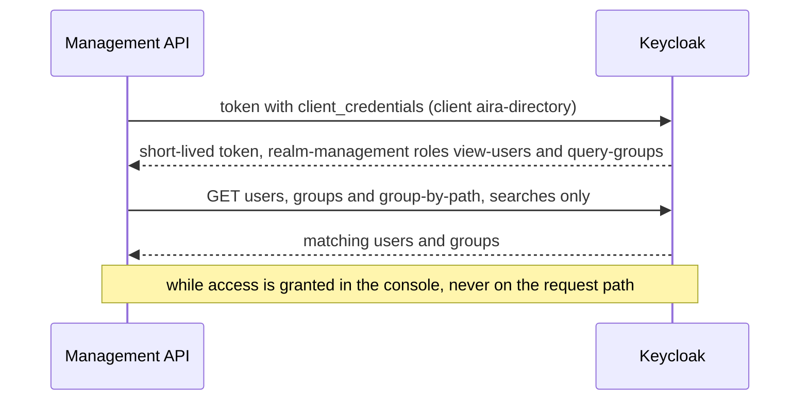

The account can read users and groups and nothing else — it cannot create, change or delete
anything in the realm. Without it the console still works: it then searches only the people AIRA
already knows and says so. Binding a role to a group is refused while the directory cannot be asked,
because a group nobody could verify is not one to grant access from.

### 8.8 The guard rails around all of this

- **Keys are stored hashed, and secrets come from where you put them.** The database passwords,
  client secrets and platform credentials are read once at start-up — from Vault where `VAULT_ADDR`
  is set, from the environment otherwise. Neither plane insists on Vault; what each refuses outside
  local development is a published development value (the gateway's sample database password,
  Management's development signing key).
- **The links between the services are checked at start-up.** Outside local development, Kafka
  over `PLAINTEXT` and an identity provider or Vault reached over plain HTTP stop the start
  (loopback excepted), because each is a link AIRA would otherwise trust completely. Redis and
  Sentinel take a password, and the delivery channel a credential of its own; those are configured,
  not enforced.
- **Both planes bound refused authentications** per source address, because every other limit in the
  system is keyed to a verified identity and therefore bounds nobody who has none.
- **The console holds no long-lived credential.** No offline token, no cookie of its own, nothing
  that outlives the session at Keycloak.
- **Only a local environment may run without authentication.** With `AIRA_AUTH_REQUIRED` off every
  route is served to anybody who can reach the port, so a deployment outside local development
  refuses to start that way — and `AIRA_DEMO_MODE`, which waives several other checks, deliberately
  does not waive this one: a demo needs the published development credentials and realm, not a port
  that serves models to anybody.
- **There is one emergency credential, and it is an ordinary key otherwise.** An operator with
  database access can mint a "break-glass" key on the gateway's command line for when the control
  plane itself is unavailable. It expires like any other key, its prefix and owner are on every
  request it makes, and it can be revoked the same way. What it lacks is a use case of its own: it
  may name one on a call, and a call that names none is the one exemption from
  `AIRA_REQUIRE_USE_CASE`, booked against the installation's own budget.
- **Every refusal is evidence too.** A request refused before it is attributed writes no audit row;
  its span is its record. A `401` is marked `aira.outcome = unauthenticated`, and a `403` for a use
  case the credential may not use `forbidden`, with the status, the subject where known, the source
  address and the use case asked for (`aira.use_case.requested`) — which is what the delivery
  channel forwards to a SIEM. Whether a span is kept is decided by the installation's sampling
  ratio (`AIRA_OTEL_SAMPLE_RATIO`), never by the caller's `traceparent` flag, so a caller can
  neither switch its own attempt off nor force one on. A ratio below 1 thins this record too.

What the realm has to provide, setting by setting — clients, group paths, the audience mapper and
the directory account — is [`INTEGRATIONS.md`](INTEGRATIONS.md) §2; the variables that configure it
are in [`CONFIGURATION.md`](CONFIGURATION.md).

---

## 9. Reading further

| For | Read |
|---|---|
| One request, end to end | [`REQUEST-LIFECYCLE.md`](REQUEST-LIFECYCLE.md) |
| Every route of both planes, and every event on the bus | [`API.md`](API.md) |
| Running it | [`deployment/`](deployment/README.md) |
| Operating it: topics, scheduled jobs, sizing | [`DEPLOYMENT.md`](DEPLOYMENT.md) |
| Every environment variable | [`CONFIGURATION.md`](CONFIGURATION.md) |
| Connecting real systems | [`INTEGRATIONS.md`](INTEGRATIONS.md) |
| What is not built yet | [`GAP-ANALYSIS.md`](GAP-ANALYSIS.md) |

If you are changing AIRA rather than running or calling it, [`CONTRIBUTING.md`](../CONTRIBUTING.md)
lists the development record behind this design.
