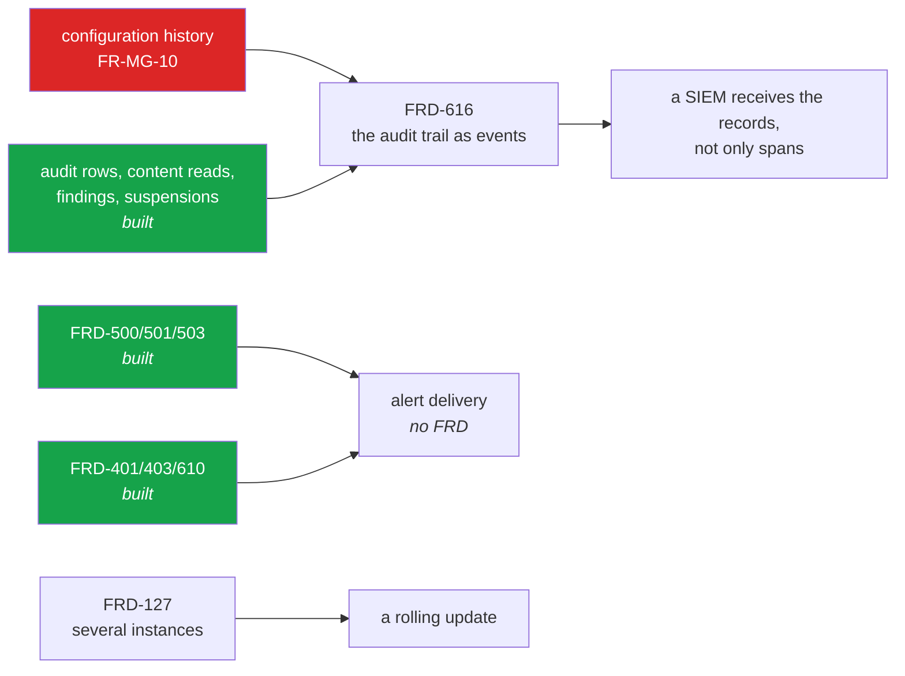

# Gap analysis — requirements against what is built

Written 2026-08-07 while documenting the system, by reading the code against
[`PRD.md`](PRD.md) §1.1 (the owner's canonical feature list), §1.2 (findings from the code review),
the PRD's requirements (§2, §5, §6) and the [ROADMAP](ROADMAP.md).

**Nothing here is fixed.** This is a statement of where the system stands, so that a decision to
close a gap is a decision somebody makes rather than a surprise somebody has. Items are grouped by
how much they matter, not by how hard they are.

Legend: done built and verified · partly partial, with the missing half named · missing not built

**Last re-read against the code: 2026-10-14.** That matters for a document of this kind: a gap
analysis is a *snapshot*, and one nobody re-reads becomes the opposite of what it is for — an
authoritative-looking list of things that were true a fortnight ago. Row 24 was `missing · not
scheduled` here while `FRD-118` had shipped.

---

## 1. The owner's central features (PRD §1.1)

| # | Feature | Stand | Where |
|--:|---|---|---|
| 1 | Unified provision of models | partly | Vertex in the EU — Gemini and Anthropic (`FRD-115`/`119`); Agent Platform's managed open models (GLM, DeepSeek), served only at `global` and so permitted by name (`ADR-0034`); Google AI Studio (`FRD-304`); any OpenAI-compatible server (`FRD-123`). Not built: Model Garden's **self-deployed** endpoints (`FRD-115` FR-2a). Foundry is built but **hermetic only** — no Azure subscription has ever run it (§3.7) |
| 2 | Role assignment | done | `FRD-201`, `ADR-0009`, `ADR-0017`/`FRD-605` — a role is held **through a Keycloak group and nothing else**; a realm role assigned directly grants nothing. What a role may do is a permission set, and an installation defines its own roles, each bound to one checked group (`FRD-614`, `ADR-0025`) |
| 3 | KIRA API compatibility | partly | `FRD-107` Stage A+B — text, documents, thinking, structured output, batch embedding; `FRD-146` — function calling, the predecessor's `gemini-embedding-2` vectors, two ids for one model, its values and statuses; `FRD-147` — reranking. Not built: **Live** (`WS /live/{model_id}`), which needs a transport of its own and decisions on budget, duration and audit; `/version-info`'s `jenkins` block, left out on purpose |
| 4 | Auditability | partly | **Requests: done** (`FRD-122`, `FRD-128`) — every request attributed to a use case leaves a row, served or refused, including one whose caller hung up; requested vs. served model, pipeline decisions and degradation are on the row. A refusal *before* attribution is recorded on its span instead (§3.2). **Configuration: not built** — only role changes have a history (§3.1) |
| 5 | Storage of requests/responses: which system, when, what, with what | done | `FRD-103` + `FRD-122` — `credential` names the calling system (an API key's prefix or an OIDC client), so five keys of one use case are five identities in the log |
| 6 | Incident response | done | `FRD-503` — suspensions with author, expiry, reason; kill switch |
| 7 | Blocking dangerous requests | partly | injection filter, personal data replaced before the prompt is sent and stored (`pii_filter`, opt-in per use case, `FRD-309`), operator kill switch; `FRD-504` **measures** what a model refuses. Not controls: jailbreak categories beyond injection, data exfiltration, output filtering — and no filter reads an attachment or a tool result (§3.4) |
| 8 | Model routing from the definition | done | `FRD-300`, `FRD-306` |
| 9 | Model fallback | done | capability-homogeneous: a chain skips an incapable candidate rather than degrading silently. **Every model access is a chain since 2026-10-11** (`FRD-302`, `ADR-0032`) — a streamed request falls back for as long as nothing has reached the caller, and each pipeline step has its own chain. What a chain does not do is in §3.6 |
| 10 | Independence from Google / Microsoft | partly | proven for **three** platforms by an architecture assertion — Foundry reused the OpenAI dialect unchanged and its diff never left `upstreams/`; still unproven against a real Azure subscription (§3.7) |
| 11 | Overview of all use cases | done | the list (`FRD-202`) and the **register** (`FRD-608`): one row per use case — purpose, processing notes, models and where they ran, storage, retention, who may read content — sortable, and exported as CSV |
| 12 | Self-service filter and routing pipeline | done | `FRD-303`, `FRD-306`, `FRD-309` — three step types: injection filter, PII replacement, routing |
| 13 | Permitted models per use case | **done** | Two gates with two owners: a Global Administrator approves a model for the *installation* (`FRD-307`), an administrator of the use case releases it to *that* use case (`FRD-308`, 2026-08-11). Both are dispatch conditions at **every hop**, so neither `model_route` nor a fallback chain goes past them. Empty means **none**. The console picks from the catalog rather than taking free text, and the `allow_check` step — which checked only the name the caller sent, once, before routing — is gone |
| 14 | Model smoke tests and jailbreak batteries | done | `FRD-504` — one flat catalogue of 100 questions, judged by a person; a standing is the **latest run**, never a sum. Since `ADR-0020` (2026-08-16) a run is put to a **use case's own pipeline** rather than to a model, so the filter, router and redactor are what is measured and a blocked question is a result; testing a model is a use case whose pipeline starts at it. Narrower than drafted: no repetition-as-a-rate, no machine-checked expectations (§3.9) |
| 15 | Budget overview and limits | done | `FRD-400`–`403`, `FRD-601`, `FRD-603`, `FRD-606` — a use case's consumption is shown **with or without a limit**, and so is each **person's**, with the two credentials shown apart and counted together. A per-head allowance belongs to the person rather than to the credential (`ADR-0019`), and one person may have a budget of their own in place of it, under the use case's (`FRD-407`, `ADR-0044`). Spend that belongs to **no** use case — the console's model checks, break-glass keys, demo traffic — books against the installation's own budget, and a model with no price cannot serve a request a cost limit binds (`FRD-610` §3.1–3.2) |
| 16 | Anomaly detection | done | `FRD-500`/`501` — seven kinds, evaluated against the audit trail: refusal rate, error rate, spend spike, request spike, a new source address for a credential, payload size, blocked-prompt rate. None of them looks for leaked data (§3.4) |
| 17 | Central overview of all use cases | done | see 11 |

**Score:** 13 built, 4 partial, 0 missing (re-counted 2026-10-14). Three of the partials are
*breadth* — each does what it says for what it covers. Row 4 is a missing half: the control plane
does not record who changed it.

> **Why this table was wrong.** Re-checked against the code on 2026-08-09 after `FRD-603`, and six
> rows understated what exists — smoke tests and Foundry were built and still recorded as missing.
> A reference table that undersells is not a harmless one: `CLAUDE.md` sends every planner here
> first, and the next person plans to build something that is already there. The rows are dated now
> so the same drift is visible rather than inferred.

---

## 2. Findings from the earlier code review (PRD §1.2)

| # | Feature | Stand |
|--:|---|---|
| 18 | Document processing (PDF, images) | done `FRD-110` — 15 media types, signature checks, a model that cannot read it is **refused by name** |
| 19 | Extensibility as a measurable property | done the assertion passes and the claim has now been tested **four** times — Vertex/Gemini, Vertex/Anthropic, Foundry, which reused the OpenAI dialect without a line of change, and Vertex's managed open models, which reused it on a second transport; the dialect gained two readings (`reasoning_content`, a `usage` with no count) that every OpenAI-compatible server benefits from |
| 20 | Secrets from Vault | done `FRD-116` — a settings source, fail-closed |
| 21 | Operational diagnostics | partly `FRD-117` — build identity, upstream health, trace header, CORS and traced outgoing calls done; Postgres alone decides readiness, and a Kafka outage reports *degraded* (FR-3a); **FR-7 (a second OpenAPI 3.0 document) not built** |
| 22 | Masking sensitive content in stored payloads | partly `FRD-406` — **credentials** are masked in every stored payload; personal data is not, by decision (§6). A use case that must not send or keep it switches on `pii_filter` (`FRD-309`) |
| 23 | Report export | done `FRD-602` — CSV as a renderer on the existing endpoint |
| 24 | Multiple Keycloak backends / groups from UserInfo | **partly** `FRD-118` — the gateway accepts several issuers, each with its own keys and audience, chosen by the token's `iss` (`AIRA_OIDC_ISSUERS`); Management verifies tokens of one. **Groups from UserInfo stays declined** (FR-3) |

---

## 3. The gaps that matter, in order

### 3.1 Configuration changes leave no history — PRD FR-MG-10, NFR-7

*Who changed this budget, and what was it before?* has no answer. Only **roles** keep a change log
(`RoleChange`: who, when, before and after). A few records name their author: an API key its
`owner` and `issued_by`, a group grant its `granted_by`, a retired use case its `deleted_by`, a
suspension its author and whoever lifted it. Nothing records who changed, or what was there before,
for model approvals and prices, budgets, rate limits, pipelines, anomaly rules, or a use case's own
settings — storage, content visibility, release, retention. Each of those rows holds its latest
value and an `updated_at`.

The outbox is not that record. An event carries no actor, and it is deleted 30 days after it was
delivered (`KEPT_AFTER_DAYS` in `apps/outbox/models.py`). Management's request spans do not name
the user either.

So the request trail answers *who asked what, and what was decided*; nothing answers *who decided
that this is what gets decided*. For a product whose claim is auditability, this is the largest
gap.

---

### 3.2 The audit trail stays in the gateway's database — [`FRD-616`](features/FRD-616-the-audit-trail-as-an-event-stream.md)

What a SIEM can be given today is telemetry. The collector's delivery channel
([`FRD-618`](features/FRD-618-any-otlp-consumer.md), `FRD-617`–`621`) forwards a span per request
and per model call, and the logs and metrics, to any OTLP receiver. The audit records themselves —
`request_logs`, `payload_access`, `anomaly_events`, `access_suspensions` — stay in the gateway's
Postgres, and the console reads them over the gateway's HTTP API. A stream of those records with a
closed vocabulary is specified in `FRD-616` and not built.

Three consequences:

- **The gateway publishes no events.** PRD FR-GW-12 — usage, audit and anomaly events on Kafka —
  was never built. Kafka carries configuration from Management to the gateway and nothing back.
- **A refusal before attribution is a span, not a row** — by design. A missing or invalid
  credential (401), a caller who names no use case (400) or one they are not a member of (403), a
  key used for another use case (403): none writes to `request_logs`, because a row per
  unauthenticated request would make the audit table a denial-of-service target. The span is
  marked `aira.outcome = unauthenticated | forbidden`, with the status, the source address, the
  subject where known and the use case asked for (`aira.use_case.requested`), and the delivery
  channel keeps it. Reporting and the anomaly rules read `request_logs`, so they do not see these
  attempts; a SIEM does. The 429 that throttles repeated failures from one address is raised before
  that mark is set, so its span carries no `aira.outcome` — the attribute the channel keeps a
  refused attempt by. A defect before dispatch answers 500 and writes no row either (logged as
  `unhandled_error`); one inside `accounting` writes a `500` / `internal_error` row.
- **Sampling thins the channel.** Its records are spans, so `AIRA_OTEL_SAMPLE_RATIO` below 1
  forwards that share of requests and refusals and no more. The installation decides the ratio; a
  caller's `traceparent` flag does not.

---

### 3.3 One gateway instance is one thing that can stop — [`FRD-127`](features/FRD-127-several-gateway-instances.md)

The owner's requirement: several gateway instances behind a load balancer, and a rolling update
that replaces one at a time. Most of it already holds — no request depends on state only one
process has, rate limits and budget reservations are counted in Redis and shared by every
instance, shutdown drains the audit queue, the anomaly evaluator takes a lock so one instance
evaluates per tick, and Postgres alone decides readiness. Two things do not:

- **Compose cannot run two.** Every service sets a fixed `container_name`, so
  `docker compose up --scale gateway=2` fails (`deploy/compose/docker-compose.apps.yml`).
- **Two versions serving at once is a rule nothing enforces** (`FRD-127` §5.4). A migration that
  drops a column the previous release still reads breaks that release while both run. The rule —
  drop it one release after the code stopped reading it — is written down and not checked.

Smaller: an audit row does not say which instance served it, and without Redis each instance falls
back to rate limits of its own, so *N* instances allow *N* times a limit — documented, bounded, and
worth an operator knowing. Management stays a single instance by decision.

---

### 3.4 Feature 7 is narrower than it reads

"Blocking dangerous requests" is three controls: a prompt-injection filter (heuristic or LLM,
`FRD-300`/`306`), personal data replaced before the prompt is sent and stored (`pii_filter`,
opt-in per use case, LLM-backed — [`FRD-309`](features/FRD-309-pii-filter.md)), and the operator's
kill switch (`FRD-503`). Not implemented: jailbreak categories beyond injection, data-exfiltration
patterns, an anomaly rule for leaked data (PRD FR-MG-6 — the seven kinds watch rates, spend, sizes
and addresses, never content), or output filtering of any kind.

What no filter reads, stated rather than fixed:

- **An attachment.** Text inside a PDF or an image reaches the model unread by either filter
  ([`FRD-110`](features/FRD-110-multimodal-content.md), `FRD-309` §2).
- **A tool result.** A file the assistant read, a fetched page, a command's output: content the
  model reads, which the injection filter cannot see. The filter's scope is `user` or
  `system_user`; the `tool_results` scope [`FRD-131`](features/FRD-131-tool-calling.md) names is
  not built.
- **An earlier turn**, by default. The `user` scope reads the last user message, so an injection
  planted earlier is not scanned again; `system_user` reads every system and user message.

A filter that asks a model is exactly as good as that model. Against a 0.6B local model the LLM
injection filter answered `INJECTION` to everything, and the PII replacer replaced one name and left
another.

---

### 3.5 Nobody is told

An anomaly finding is a row, shown in the console — **Security → Findings**, and **Warnings** on the
use case. Nothing sends it anywhere: no mail, no webhook. Who gets told is a decision with its own
blast radius, and `FRD-503` leaves it unmade.

Budgets have the same shape. The console colours a bar from 80 %, and a caller can read its own
allowance (`GET /v1beta/me/budget`, `FRD-139`). A developer in OpenCode with the budget plugin sees
it in the session sidebar and is warned at four fifths and at the limit (`FRD-144`); every other
caller is told nothing before a limit refuses, and a use case learns it is over budget when its
traffic starts failing with a 429.

---

### 3.6 What a fallback chain does not do — [`FRD-302`](features/FRD-302-model-fallback.md) §6

- **No fallback after the first streamed chunk.** Splicing two models' text into one answer is
  worse than the failure; stated, not deferred.
- **No retry of the same model.** A chain of one is still a chain of one.
- **The reservation is made against the model routing chose.** A fallback with a larger output cap
  or a higher price is settled at what it used; a chain does not widen the reservation to its
  costliest candidate. Under concurrency the requests in flight therefore count for less than a
  fallback then spends.
- **A slow stream that is refused is a `200` with an error at its end** ([`ADR-0046`](adr/ADR-0046-a-stream-is-never-silent-for-long.md)).
  The status waits for the chain at most `AIRA_STREAM_KEEPALIVE_SECONDS`; a refusal after that is
  the stream's last element. Stated, because the alternative was a stream silent for minutes.
- **A region that cannot be reached does not move the regional failover on.** A refused connection
  or a connect timeout is an `UpstreamError` without a status, and `regions._across_regions` moves
  on only for a status about the place; the fallback chain still moves on to the next model.
- **A non-streamed request cannot be kept alive, and one whose caller left is recorded as served.**
  No byte can precede its status, so a proxy's read timeout bounds the answer; and nothing tells
  the gateway the caller has gone before it sends the answer, so the row says `served`.

---

### 3.7 Two upstreams have never answered a request — `FRD-120`, `FRD-115` FR-2a

**Microsoft Foundry has never met Azure.** The transport, the routing axis and the dialect are built
and hermetically tested. **No Azure subscription has ever been called.** Everything the earlier live
rounds found — a model name with a colon, usage in an empty `choices` array, missing stream usage —
was found by running against a real endpoint, and none of those classes of defect can be ruled out
here. Feature 10 ("independence from Google/Microsoft") is therefore proven against live endpoints
for Google and for a self-hosted server, and for Microsoft only by the architecture assertion.

**Model Garden's self-deployed endpoints are not built.** Models deployed onto the installation's
own capacity — Nemotron and similar NIM containers — are addressed by endpoint id and fail
differently, with cold starts and capacity-shaped 429s. The managed open models on the same
transport are built; the addressing and the cold-start policy for these are not written.

---

### 3.8 Contracts that exist only in code

- **Kafka events carry no version.** An event is JSON with an `event_type` header; there is no
  version field and no schema module. The two planes are kept in step by cross-plane tests in
  `tools/tests` (for example `test_the_two_planes_agree_on_the_event_vocabulary.py`). The Compose
  stack runs a `schema-registry` container that no code uses; removing it is open, because a local
  overlay still names it.
- **No API reference.** Management's API has no OpenAPI document — it renders JSON and nothing
  describes it. The gateway serves `/openapi.json`, `/docs` and `/redoc` only locally or in a demo,
  so a deployment publishes no map of its control, reporting and incident endpoints. `FRD-117`
  FR-7, a second OpenAPI 3.0 document for clients that cannot read 3.1, is not built either.

---

### 3.9 The question catalogue asks each question once — [`FRD-504`](features/FRD-504-model-smoke-tests.md)

**Built**: AIRA has evidence about what comes *back*, by one mechanism — the catalogue is put to a
use case's pipeline, so running it against a filtering pipeline measures the filter and running it
against a bare one measures the model (`ADR-0020`). What remains open is §5.2 of the FRD: a case
runs **once**, so the result is an anecdote where the specification asked for a rate over repeated
attempts, and a model that refuses nine times in ten still reads as a refusal. A person judges every
answer; nothing is checked by machine.

---

## 4. Smaller, known, and written down

| Gap | Note |
|---|---|
| Whoever can write to the configuration topics configures the gateway | The consumer applies what arrives there to the read-model its authorization comes from, and the broker's credentials are the only boundary: outside local the gateway's API process and Management refuse `PLAINTEXT`, the consumer and retention workers check nothing, and `SASL_PLAINTEXT` and TLS without a client certificate pass everywhere. Signed events and the stricter transport rule are built and not merged, because both need infrastructure that already runs to change — a signing key in Vault, its public half with the gateway, TLS with an identity per service at the broker |
| A use case purged before retirement ended its children can grant again on a replay | Each child is on a compaction key of its own; for a use case purged before retirement and purge ended them there, the children's last records still grant, a rebuild or an offset reset applies them again, and a re-created slug inherits them. Management no longer holds the rows that name those keys |
| Google AI Studio embeddings are booked unpriced | Its embedding answer carries no token count, so such a request is counted apart as unpriced and no cost limit sees it (Vertex and the OpenAI dialect report one). What AI Studio returns has not been looked at live |
| Audio input is priced at the text rate | Several Gemini models price audio input apart; the catalogue has one input price, and no dialect's audio share of the prompt is read. A price field on both planes and the share from each dialect's usage is the feature |
| The trace context travels to the model providers | The HTTP instrumentation sends `traceparent` and the caller's `tracestate` with every upstream call; the privacy register does not name it. Whether providers should receive it at all is open |
| `FRD-625` §11 — two decisions the privacy notice states | IP addresses in finding details (mask them or keep them); no automatic deletion outside request content — findings, suspensions, counters, accounts of people who left, and records kept forever by default |
| `FRD-121` — document conversion for models that cannot read a type | Deliberately not built: the recommendation is to refuse rather than convert |
| Local model prices | Invented, and they say so in their display name |
| OpenCode is offered fewer thinking settings than a model takes | The console's OpenCode file offers off, the four level words OpenCode's Google client can send, and `auto`. Claude's `xhigh` and `max` are not offered, because that client refuses them before sending, and neither is a token budget, whose ceiling does not fit inside the output cap OpenCode sends. The showcase's file offers none: the model listing it is built from carries no thinking declaration |
| Claude's thinking blocks are carried, and not yet measured against Claude | Within a tool loop a Claude model gets its own thinking blocks back, carried in the signature of its first function call. No Claude model is reachable from the environment this was built in: the blocks follow Anthropic's documented rules, and a refusal of them is sent once more without, so a mistake costs one refused request. A client that drops a call's signature — the AI SDK's first major — continues without the model's reasoning |
| A model's thinking default is the vendor's statement, read once | The model reference proposes what a vendor documents a model doing when a request names no thinking setting, from a table of named models. A model the table does not name, or a vendor that changes its default, is proposed nothing, and an administrator decides |

---

## 5. Closed, and by what

Kept so a closed gap is not reopened by somebody reading an older copy.

| Was a gap | Closed by |
|---|---|
| No governance view of the processing logic (rows 11, 17) | [`FRD-608`](features/FRD-608-governance-overview.md) — the register, with CSV. `FRD-600`, the number this row used to name, was never written |
| The IT Security console did not exist | `FRD-502` — findings, suspensions and the kill switch, the rules, warnings per use case |
| Per-request browsing waited on redaction | `FRD-505`, [`ADR-0016`](adr/ADR-0016-content-is-readable-and-every-read-is-recorded.md), `FRD-622` — stored content is readable by role, and every read is recorded |
| Nothing was paginated | `FRD-207`/`FRD-208` — the use-case list is paged at the server; findings and requests are paged by cursor |
| Membership could drift between Keycloak groups and Management | [`FRD-209`](features/FRD-209-access-by-group.md) — a grant names a group or a person, and both planes resolve it with `aira_common.access.resolve` |
| An unpriced model escaped a cost limit; the console did not say when budgets were off | `FRD-610` §3.2 (`AIRA_ENFORCE_PRICED_MODELS`) and §3.3 |
| A request that set no output cap reserved a guess, and a burst booked many times its budget | `FRD-405` §4.2 — what bounds the answer is reserved (the cap sent, else the model's maximum), and a rebuilt counter keeps the reservations still open |
| A purged use case's members, grants and keys came back on a replay, onto a re-created slug | [`FRD-607`](features/FRD-607-retiring-a-use-case.md) §4.1b — retirement ends each child on the child's own key, and a purge again for a retirement that did not |
| A stream its caller left booked nothing on most dialects | [`FRD-128`](features/FRD-128-one-post-dispatch-sequence.md) FR-7, `ADR-0041` — the upstream is read to its end and booked at the vendor's last report |
| A stream was silent until the model's first visible word, and callers behind a proxy were recorded as gone (`499`) | [`ADR-0046`](adr/ADR-0046-a-stream-is-never-silent-for-long.md) — the status goes out within `AIRA_STREAM_KEEPALIVE_SECONDS`, and a quiet stream sends a keepalive |
| A Claude model lost its own reasoning at every step of a tool loop, and a thinking budget could not continue a call | [`FRD-152`](features/FRD-152-claudes-thinking-travels-with-the-turn.md), [`ADR-0047`](adr/ADR-0047-a-models-turn-state-travels-with-the-caller.md) — the thinking blocks travel with the function call and go back in their places |
| A model's reasoning never showed in OpenCode | [`FRD-151`](features/FRD-151-a-models-reasoning-in-opencode.md) — the console's file offers the catalogue's thinking settings as variants, and a model that thinks unasked has a default proposed from its vendor's documentation, which is what makes the gateway ask for the reasoning |
| A failure did not say whether AIRA or the provider stopped | `FRD-628` FR-6, `FRD-141` — a message names who acted, AIRA's own time limit is a `504`, the console says where a request ended |
| The pipeline dry run did not ask a step's model the price condition | `FRD-306` — a dry run's steps meet production's conditions, and it weighs one per step |
| A `pii_filter` did not reach an embedding | `FRD-309` FR-9 |
| The approved-model catalog had no pickers | `FRD-307`, with the pickers in `FRD-308` |
| No Git remote, and CI had never run | `origin` is on GitHub; `.github/workflows/ci.yml` runs on every push, and a release is published only behind its gates (`FRD-137`) |

---

## 6. What is *not* a gap, though it might look like one

Recorded so the same questions are not re-asked:

- **No agent features.** No retrieval, no vector storage, no conversation state, no tool execution,
  no workflow orchestration. This is [`ADR-0013`](adr/ADR-0013-auditable-model-access-not-agents.md),
  a decision rather than an omission. The test for any request: *does this make model access better
  governed and better evidenced, or does it make the gateway think for the use case?*
- **No OpenAI-compatible surface** (`FRD-106`). Withdrawn by the owner; `FRD-132` then measured a
  coding assistant on the Gemini surface, and no new surface was needed. The OpenAI *dialect* as an
  upstream is built.
- **No parallel pipeline execution** (PRD FR-GW-5, FR-MG-3). The engine is an ordered walk
  (`FRD-300`): a step can rewrite what the next one reads — `pii_filter` replaces names before a
  router classifies the text — so the order is part of what a pipeline means.
- **No "project"** (PRD G3, FR-GW-3). The use case is the unit of attribution, of grants, of budgets
  and of reporting; there is no project entity.
- **Personal data in a stored payload is not masked by default.** The PII half of `FRD-406` is
  declined (`ADR-0016`): the sensitive content and the useful content are the same content. Stored
  content is readable by role, and every read is recorded. A use case that must not send or keep
  personal data replaces it with `pii_filter` or switches storage off (`FRD-404`).
- **Groups from UserInfo** (`FRD-118` FR-3) — declined; several issuers (FR-1) is built.
- **A group grant may name a group Keycloak does not have yet** (`FRD-209`). Grants are checked for
  shape, not existence, so a department can be granted before its group is created. In the console
  a grant is picked from the directory search; through the API a mistyped path is a grant that
  reaches nobody, and the grant list says `reaches: 0`. Only a role's group is checked against
  Keycloak, and that is refused while Keycloak cannot be asked.
- **`usecase.manage_all` does not reach into the gateway.** Its holder administers every use case in
  Management; calling a use case, or trying a pipeline on it, still takes a grant
  ([`ADR-0007`](adr/ADR-0007-security-hardening-baseline.md): visibility never implies the right to
  act inside a use case).
- **Whole-row retention defaults to never.** Deliberate: deleting rows would truncate the spend
  history that cost reporting is made of.
- **`alert` is the default for a new anomaly rule.** A safety property, not timidity.
- **Kafka is not on the incident path.** The kill switch writes straight to the gateway, because a
  control that depends on the event bus fails exactly when the bus is the problem.
- **Rotation is a restart.** Vault values are read at startup; recorded as a decision.

---

## 7. If somebody asked "what would you do next"

Not a plan — the owner sets priority — but the dependencies are worth stating, because two of them
are not obvious:

The configuration history is the item something waits on: `FRD-616` can stream only what is
recorded, and the control plane records almost nothing about who changed it. Alert delivery has
every input it needs and waits on a decision rather than on code — who gets told. `FRD-127` needs no
new mechanism, only the two changes named in §3.3. Everything else is breadth.
