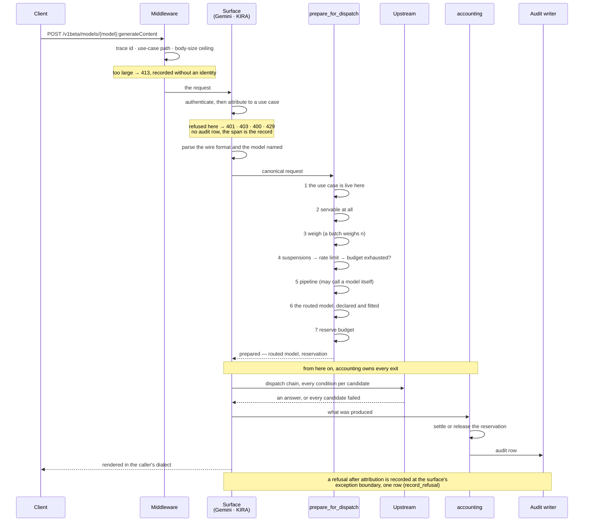
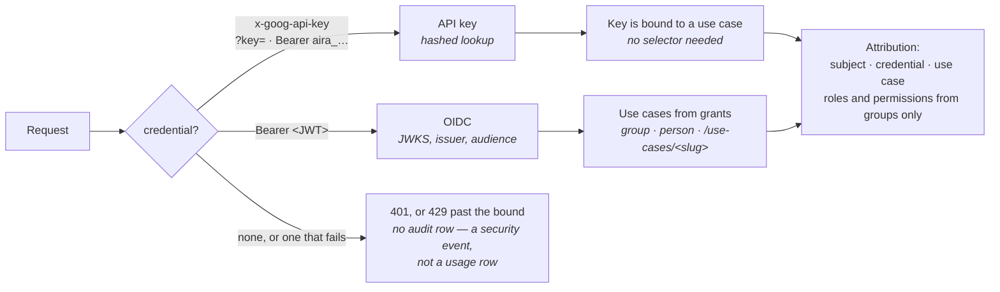
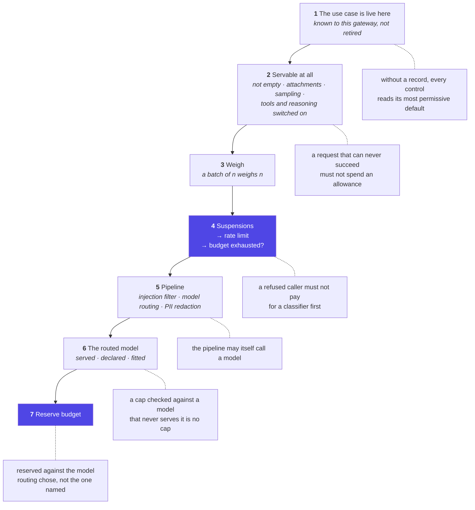
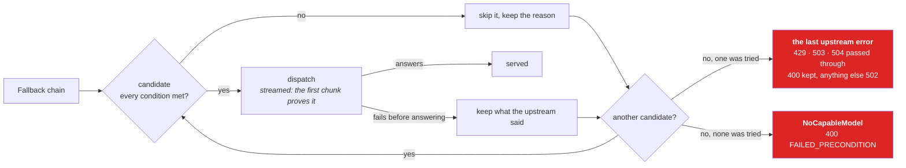
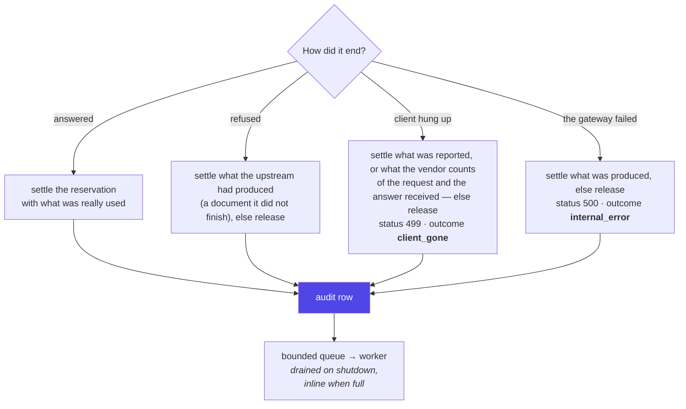
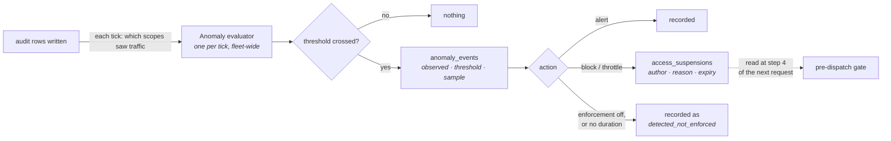

# One request, end to end

What happens between a client sending a prompt and receiving an answer — every control, in the
order it runs, and what each one costs if it is skipped.

The order is not incidental. It is owned by one function, `prepare_for_dispatch` in
[`gateway/src/aira_gateway/api/serving/prepare.py`](../gateway/src/aira_gateway/api/serving/prepare.py), because
**every guarantee this layer makes is a guarantee about the order**. Two surfaces lead into it — the
Gemini-compatible one and the KIRA compatibility layer. Where they differ this document says so,
and §8 lists what each of them answers.

---

## 1. The whole path at a glance

---

## 2. Before any route: the middleware

Up to five things run outside the application, in this order (outermost first):

| Middleware                  | Does                                                   | If it refuses              |
| --------------------------- | ------------------------------------------------------ | -------------------------- |
| `TraceIdMiddleware`         | puts `x-trace-id` on **every** traced response         | —                          |
| `SecurityHeadersMiddleware` | `nosniff` · `no-referrer` · `DENY` · `no-store`        | —                          |
| `CORSMiddleware`            | the cross-origin headers, with `AIRA_CORS_ORIGINS` set | —                          |
| `UseCasePathMiddleware`     | reads `/uc/<slug>` from the path                       | — (the route checks the slug after authentication: a bad credential is a 401 first, then an invalid slug a 400) |
| body-size ceiling           | counts bytes, enforces `AIRA_MAX_REQUEST_BYTES`        | **413**, and records a row |

**The order is what decides which responses carry the headers.** The ceiling is enforced by
wrapping `receive`, so nothing above it buffers anything either way, and it is innermost: its 413
passes through every layer above it, headers, trace id and CORS included. It sits inside the path
selector, so it refuses on the path every route sees — `/uc/<slug>/kira/…` is a KIRA request when it
is too large too, answered in KIRA's envelope and audited as `api="kira"`. The one response no
middleware reaches is Starlette's answer to an unhandled error, a 500 written outside all of them;
its handler adds the security headers, the trace id, the KIRA surface's headers and the CORS
headers itself.

The ceiling has two exits — a declared `Content-Length` that is too large, and a body that lies and
is cut off mid-read — and **both record an audit row** under the outcome `request_too_large`. That
row carries **no identity** on either exit, because the middleware writes it and the middleware
reads no credential. For a declared length nothing has verified the credential yet, and recording
an unverified claim would let anyone write another system's name into the audit trail with one
oversized request. A body cut off mid-read has passed authentication already — a route reads its
body after that — and is recorded the same way. The row does carry where the request came from, by
the same trusted-proxy rule as every other row, and its size.

That size — the declared `Content-Length`, or the bytes counted when the body was cut off — is what
`payload_size` anomaly rules measure against, so it is carried onto the row rather than counted
twice. A declared length is the caller's own number, so it is recorded at most at what the column
holds.

---

## 3. Authentication and attribution

Two credential kinds, one `Principal`, then one use case:

- **The credential** is read from `Authorization: Bearer`, then `x-goog-api-key`, then `?key=`.
  Every refused attempt — none presented, or one that fails — counts against a bound per source
  address: past `AIRA_MAX_AUTH_FAILURES_PER_MINUTE` (60) in a minute, the answer is **429** with
  `Retry-After` instead of the 401, because the credential was not judged. A working credential
  never touches that counter.
- An **API key** (`aira_<prefix>_<secret>`, hashed at rest) is bound to its use case. A mismatched
  `/uc` selector or `X-AIRA-Use-Case` header is a **403**, not a silent override.
- An **OIDC bearer** carries **group memberships, and roles are read from those and from nothing
  else**: `AIRA_ROLE_GROUPS` maps a group path to a role, and a realm role assigned directly grants
  **nothing**. What a role allows is a permission set ([`ROLES.md`](ROLES.md) lists them): the
  gateway resolves the token's groups against its `roles` read model, fed over `aira.roles` and
  cached for five seconds, and every installation-wide check asks one permission. Use-case
  membership is the union of three routes — a grant to one of the person's groups, a grant naming
  the person, and the `/use-cases/<slug>` convention — and the strongest role wins. A non-member
  gets 403.
- **Which use case.** On the Gemini surface, the `X-AIRA-Use-Case` header, else a `/uc/<slug>` path
  prefix; a key issued by Management brings its own. A model request that names none where one is
  required is a **400**. The KIRA contract has no field for a use case, so that surface also takes a
  person's only membership when none is named; a person with several is refused with a **403**
  naming them, and one with none, where one is required, with a 403 too. A selector in a form that
  is not a valid identifier is a 400 on both surfaces. A read (`GET`, `HEAD`, `OPTIONS`) needs no
  use case.
- The **credential identity** (an API key's prefix, or the OIDC client id) travels onto the audit
  row separately from the subject. Without it, five keys issued for one use case by one person are
  one identity in the log, and a leaked key can be revoked but its blast radius cannot be assessed.

**A request refused here leaves no audit row**, and that is a decision: it was never attributed,
and an unauthenticated request is a security event, not a usage row attributed to nobody. Its
**span** is its record, marked with `aira.outcome`, the status, the source address, and — where
they are known — the subject, the credential and the use case asked for (`aira.use_case.requested`):

| `aira.outcome` | refused for |
| --- | --- |
| `unauthenticated` | no credential, one that does not verify (401), or too many of those from one address (429) |
| `forbidden` | a use case the credential may not act on (403) |
| `unattributed` | a known caller whose request no use case could be attributed to: none named where one is required, a malformed one (400), or — on KIRA — several or none to choose from (403) |

That outcome is what keeps a refused attempt in the **delivery channel**, the collector's
forwarding to a second destination such as a SIEM: it passes on a request's own span, recognised by
`aira.use_case` or `aira.outcome`, and the model calls made inside it — and a request refused here
carries no `aira.use_case`
([`INTEGRATIONS.md` §6](INTEGRATIONS.md#two-destinations-that-want-different-things)). Which spans
are kept is decided by the installation's sampling ratio, never by the caller's `traceparent` flag,
and a ratio below 1 thins this record too.

From here on a request is attributed, and every refusal writes a row.

---

## 4. The pre-dispatch sequence

**Before it, each surface does its own part.** The Gemini surface refuses a model nothing serves
(**404**, before the body is read), a body that is not JSON or carries a field Google's API does not
define (**400**, naming the field). The KIRA surface
turns the predecessor's numeric model id into a model (**422** `MODEL_NOT_FOUND`; **503** when the
id is assigned to two models), applies the contract's own checks (**422** `NO_CHAT_CAPABILITIES`,
`INVALID_MAX_TOKENS`, `MAX_TOKENS_EXCEEDS_CAP`), and accepts a field it does not model, naming it in
`X-AIRA-Unmodelled-Fields` (§8).

Then seven steps, one owner. The right-hand column is what breaks if the step moves.

### 1 — a use case this gateway holds, live

A use case is served only while this gateway **holds its record, live** — the first thing
`prepare_for_dispatch` asks (`refuse_unless_live`). Every control a use case carries lives on its
read-model row: its release, whether its content is stored, its retirement. A slug without a row is
a **403** ("not known to this gateway") rather than a request served with each control's permissive
default, and a use case created a moment ago serves once Management's event describing it has
arrived over Kafka. A retired one is a 403 too. Both are recorded as `invalid_request`. A model
request that names no use case — the break-glass key's — is not this rule's to refuse.

### 2 — what can never succeed is refused before it costs anything

A generation with no text and no attachment; more attachments, or more bytes of them, than one
request may carry; a sampling value outside the range every dialect accepts, named; functions
declared where the use case has not switched tool calling on; the model's reasoning asked for where
the use case does not return it. For an embedding, an empty batch or one beyond the bounds. Each is
the caller's to fix (§8), and each is refused before the rate limit takes its weight.

### 3 — the weight

An embedding batch weighs one request per text, against the rate limit and a request budget alike;
every other request weighs one.

### 4 — the gate every verb passes

`guard_before_work` checks, in order: **suspensions** (is this caller stopped?), **rate limits**
(token bucket, all-or-nothing across use-case and member scopes), and **already over budget**.

A suspension that **throttles** rather than blocks is one more bucket in the same all-or-nothing
take. Its refusal is recorded as `suspended`, not `rate_limited`, and it applies even with
`AIRA_ENFORCE_RATE_LIMITS=false`: suspensions have their own switch, `AIRA_ENFORCE_SUSPENSIONS`. A
batch that weighs more than a bucket can ever hold is a **400**, not a 429, because no wait would
admit it.

A request that names **no** use case meets no use-case rate limit and no "already over budget"
here — both are per use case. It is bounded at the reservation (step 7) instead, by the
installation's own budget, the residual bucket for spend no use case owns: a break-glass key's
call, a demo. The console's model checks never come this way: they are `diagnostic` rows, recorded
and not capped (§8).

A per-head allowance is counted against the **person**, not the credential: an API key and a
Keycloak sign-in by the same human share one budget and one bucket. A suspension is the exception
and deliberately so — it aims at exactly what it names, so blocking a leaked key does not block the
person holding it.

It is called once, _before the verb branch_. Inside the pipeline it would have been tidier, and every
request that runs no pipeline step — a use case with no pipeline, an embedding without a
`pii_filter` — would have passed it unlimited. That is the reason this project writes controls on
the path every branch takes rather than inside one of them.

**Cost of getting this wrong, measured:** with the pipeline running first, one served request and
seven refused ones spent 72 400 against a 20 000 cost limit — the refusals cost more than the answer.

### 5 — the pipeline

Per use case, config-driven, authored in the SPA's graph builder:

| Step               | Does                                       | Notes                                                             |
| ------------------ | ------------------------------------------ | ----------------------------------------------------------------- |
| `injection_filter` | heuristic patterns, or an LLM classifier   | verdict is **three-valued**; `undetermined` **blocks** by default |
| `model_route`      | an LLM classifier picks a category → model |                                                                   |
| `pii_filter`       | a trusted model rewrites the user's text   | **blocks** by default when it cannot; the caller is told          |

**What the filter reads — worth stating, because each is a limit of *reach* rather than of
verdict.** Its `scope` defaults to `user`, which is **the last user message**: an injection planted
in an earlier turn of a conversation is not re-scanned when the next one arrives. A conversational
use case should set `system_user`, which reads every system and user message; a scope the gateway
does not know reads them all as well, and an `action` it does not know blocks. No scope reads
**attachments** — the text view of a message excludes them, so an injection inside a PDF is
invisible to every step here — and none reads **tool results**: a file the assistant read or a page
it fetched reaches the model unscanned, because the text view leaves out a tool's result as it
leaves out an attachment, and the two scopes differ only in which messages they read. And the
**heuristic reads at most `MAX_SCANNED_CHARS` (20 000) characters of a text — its first and last
10 000** when it is longer: the patterns run on the event loop and one unbounded repeat costs time
in the square of what it reads. What lies between the two ends is not scanned; the dry run shows
how much, and the gateway logs `injection_scan_partial`. None of these is a bug; each is the
difference between "the filter ran" and "the prompt was checked", and a reader who assumes the
second has been misled by omission.

**The PII filter rewrites the last user message only.** A chat client sends the whole conversation
every turn, and its own copy of earlier turns was never redacted — so from the second turn on, what
the caller typed earlier reaches the model and the stored payload as it was typed, while the step
records `unchanged` or `redacted` for the last one. A stated blind spot, like the filter's scope
above.

**An embedding runs the steps that are about the text it carries, and not the others.** A step
about the *answer* has nothing to act on — a router chooses a model to generate with, and an
injection filter is about a prompt that will be **obeyed**, which an embedding never is. A step
about the *text itself* applies exactly as it does to a prompt, so a `pii_filter` runs on
`:embedContent`, `batchEmbedContents` and `/kira/api/external/embed`. Every text of a batch is
offered to the redactor and one that cannot be redacted refuses the whole request: half a batch of
vectors is not an answer.

There is no `allow_check` step: which models a use case may call is a property of the use case, its
release, checked as a dispatch condition at every hop. As a step it would run once, before routing,
and a route or a fallback would go straight past it.

Every model a pipeline names — the classifier a filter runs, the classifier a router runs, each
category's target, the default target, the fallback chain — must be **released to the use case**.
Refused when the pipeline is saved and again at dispatch, and the builder offers only those. The
dry run follows the same rule and the membership rule with it: it calls a real model, so it belongs
to a use case exactly as a request does — and it asks of every model it will *call* that a Global
Administrator has approved it for the installation, which the release alone would not ensure: until
an event from Management has described a use case's release, the release refuses no model, and
approval has no such undecided state. It asks both up front rather than per call, and never asks
the price condition a production step asks (below).
**Trying a pipeline is authoring one**: an unsaved pipeline, and steps run past a block, are for the
use case's administrators; a member may test the saved pipeline and sees what each step decided, not
what its model wrote. A malformed `pipeline` is a `400` naming the field.

**A step reaches only the models written in its own configuration.** A step that names none does
not borrow a model nobody chose. It degrades instead: the redactor blocks, the LLM filter falls back
to the heuristic, the router uses its `default_model`.

**And only those this request may reach.** The names were checked when the pipeline was saved, but
a release withdrawn or an approval revoked since does not change a saved pipeline — Management
accepts both, as it should — and a step that did not ask again would go on sending the caller's
text to a model the installation withdrew. So a step asks of each model, before calling it, what
the dispatch chain asks of every candidate — residency, approval, release, and a price where spend
is capped (`installation_requirements`). A model it may not call is passed over **with its reason**,
and the step degrades as above, saying why.

A step may name **more than one**: its own `fallback_models` chain, tried in order where the model
before it could not be *reached*. Reached, not agreeable — a model that answered `UNDETERMINED`, or
returned a rewrite too short to trust, has answered and the chain stops, because a filter that kept
asking until some model agreed would get weaker exactly when things get worse. What a chain adds is
a candidate; what it never removes is the safe direction above. Every name in it is checked against
the release when saved and against the installation's conditions when called, like every other.

**A pipeline model call is a first-class request**: it leaves its own audit row named
`pipeline:<step>`, priced, and booked against the budget **as a request** — it reached a model and
cost money, so a use case running two steps per request is doing three times the work its request
budget was sized for. That row stores no prompt. It does **not** take a rate-limit token: a bucket
measures how fast requests arrive, and the gate above is taken once, on the one request that did.
Measured against a real model, the classifier costs roughly as much as the answer it guards.

A filter that ran and **passed** records that it did, so "found nothing" and "none configured" are
told apart.

### 6 — the routed model: declared, then fitted

After routing, the model that will be asked first is the routed one. It must have a provider (a
**404** otherwise), and it must pass the catalogue's own rules: it generates — for a spoken answer
the speech capability is asked instead, per hop — and a cap the caller set is positive, within the
model's declared maximum and within what the counters can hold.

The catalog is a **runtime authority**. It declares eight capabilities — `generate`, `embed`,
`structured_output`, `thinking`, `attachments`, `tools`, `prompt_caching` and `speech` — beside the
output cap, the per-model default cap, the thinking modes and levels, the media types it reads and
a deprecation. **Undeclared means the baseline and nothing more** — absence of information is not
permission.

Checked **after routing and at every hop of the fallback chain**, because a chain that quietly
answers with less than was asked for returns a 200.

**And fitted per hop.** What the caller left to the model — the output cap when none was set, the
thinking, the cache marker — is filled in by the model being tried, never by the model in front of
it: the chain starts from the request as the caller made it and fits it to each candidate the way
the routed model was fitted (`fitting`). A cap the caller *did* set is a condition on every
candidate, so a fallback declaring a lower maximum is passed over by name rather than called. A
thinking budget has to fit inside the cap that will be sent: for the routed model that is the
caller's 400, for any other candidate a reason to pass it over.

**One capability is deliberately not a condition**: `prompt_caching`. Every other flag guards the
_answer_ — a candidate that cannot read the attachment would answer about a document it never saw,
so the chain moves on. A candidate that cannot cache answers exactly the right thing and merely
costs more, so it is served **uncached** rather than skipped: refusing a request over a price is the
opposite of what a fallback chain is for. Resolved here all the same, because whether the request
carries a cache marker depends on the model it landed on and on the use case's own switch and
lifetime.

### 7 — the reservation

Budgets **reserve** before dispatch and settle or release afterwards. Without the reservation, N
concurrent requests all pass a limit with room for one, because each reads a usage figure none of
them has booked yet: of twenty requests in flight against room for one, all twenty pass a check that
only reads, and one passes the reservation. Requests in flight see each other's reservations; what
refuses is a counter already at its limit, so a request larger than what is left is still admitted,
and settling can take a period past its limit.

What is reserved is the request's **whole** expected consumption: the output cap that will be sent
— the caller's, else the model's declared default, else `AIRA_BUDGET_ESTIMATE_OUTPUT_TOKENS` (1024)
— and a thinking budget (output), and the prompt — counted at four characters a token — with each
attachment at what the model declares (input), each side at its own price. A reservation of the
output alone would let a dozen agentic requests, each carrying a 100 000-token context, all pass a
50 000-token limit together.

It is made against the routed model and nothing else. A fallback that costs more, or is sent a
larger cap of its own, is settled at what it used, and the chain does not widen the reservation to
its costliest candidate — so under concurrency the requests in flight can count for less than a
fallback then spends.

---

## 5. Dispatch

A candidate that fails a condition is **skipped with its reason kept**, and a candidate that was
*tried* and failed is kept with what the upstream said. Both reach the audit row's
`pipeline_decisions` — `step: dispatch`, with the action `skipped` or `failed`, the model and the
reason — **whether a later candidate answered or none did**: the error an exhausted chain raises
carries both lists, and the refusal's row records them.

**What an exhausted chain answers** depends on whether anything was tried:

- **Nothing was tried** — every candidate was excluded: **400 `FAILED_PRECONDITION`** naming each
  candidate and its reason, outcome `no_capable_model`. "Every candidate was excluded" is fixable by
  an operator; a 502 would send the reader to the wrong place. Where every candidate was skipped
  because its wire format cannot carry the request, the dialect's own refusal is the answer instead
  (below).
- **At least one was tried and failed** — the last upstream error is the answer, outcome
  `upstream_error`: an upstream 429, 503 or 504 is passed through, an upstream 400 becomes
  **400 `FAILED_PRECONDITION`** carrying its reason, and anything else — a 401 or 403 included, and
  a platform that could not be reached — is a **502** (§8).

**A streamed request uses this chain too.** The chain is *opened* rather than awaited: for each
candidate in turn, the conditions, then the upstream stream, then its **first chunk** — the
`__anext__` that issues the HTTP request. A candidate that fails before producing that chunk is
passed over; the one that produced it owns the rest of the answer. Two things follow. The response
does not begin until a model has produced something, so a streamed request nothing can serve is a
**status** rather than a `200` whose body is an empty array; and once a chunk is on the wire the
stream is **committed**, because text from two models spliced into one answer would be worse than
the failure it hid.

**What a candidate must meet**, asked of every candidate by one mechanism (`requirements_for`)
rather than each feature inventing its own:

- **always** — properties of the installation, which a pipeline step asks of its own models too
  (`installation_requirements`): **residency** (one policy for every cloud, a model permitted a
  further region by name included), **approval** by a Global Administrator, **release** to this use
  case by its administrators, and — while `AIRA_ENFORCE_PRICED_MODELS` is on, the default — **a
  price**, wherever a cost limit binds this caller;
- **when the request asks for it** — the **media types** of its attachments, **structured output**
  and whether the dialect can express the **schema**, the **thinking** setting, the **output cap**
  the caller set, **sampling** the dialect can express, **tool calling**, and **speech**, which only
  the Gemini surface can ask for.

Each asks about what the caller asked for: a default the model in front of a candidate declares is
that model's, not a condition on the next. Sampling expressibility is a property of the _dialect_,
since no catalog entry can say whether `top_k` exists. A candidate no provider serves is skipped the
same way, and so is one that cannot be addressed — no region catalogued, or one outside the list.

A candidate whose **wire format cannot carry** the request — found while its body is built, one
step after the conditions: a thinking budget that does not fit Anthropic's output cap, thinking on a
Claude turn that continues a function call — is skipped the same way, by name. Where every candidate
was skipped for that reason, the dialect's own refusal is the answer (a `400` naming what to
change). And a stream counts as **failed**, not finished, when the provider reports an error inside
its `200` or the connection breaks: before the first chunk the chain moves on; after it the audit
row says `upstream_error`, what was reported is settled, a Gemini client receives Google's own
error element as the stream's last — which the google-genai SDK raises, where a stream that merely
stopped would read as a complete answer — and a KIRA stream ends without its `completed` event.

**The rule that matters:** a model that cannot read the attachment is refused **by name**, never
sent the prompt without it. A dropped attachment produces no error — it produces a fluent wrong
answer with a 200, and the caller blames the model.

---

## 6. After the answer: `accounting`

One context manager owns every way out:

The audit row carries: who (the subject, the name they go by, the realm that signed their token)
and what system (the credential), which use case and which surface, requested **and** served model,
how the model was chosen, provider/publisher/**region**, status and outcome, pipeline decisions —
each step's verdict, and every candidate the chain skipped or tried — whether a step flagged the
request, the tools offered and the names of those called, tokens and how they were established
(`usage_basis`), latency, cost in nano-units, request bytes, trace id, and which controls were
degraded at the time.

**A request that reached this point is recorded however it ended.** A dropped socket _cancels_ the
response task, so settling or releasing the reservation and writing the row run to their end as one
unit (`shielding.uninterrupted`). Shielding the wait alone is not enough: Starlette cancels a
streamed body through anyio, whose cancellation is re-delivered to every await in the cancelled
scope, so control would leave the exit while the settle still ran and the reservation would be
resolved twice. A stream whose body never began — cancelled while its headers were sent — is
accounted for by its response instead (`AccountedStream`).

A refusal raised **after** the upstream answered — a document the model did not finish — was paid
for: what it spent is settled, and its row carries the tokens and the cost.

**A defect is recorded where `accounting` sees it.** An unhandled exception inside it leaves a
`500` / `internal_error` row, settled like any other exit. One raised before dispatch reaches the
application's last-resort handler instead: the caller gets a `500` with its trace id, a reservation
already made is given back, and the failure is logged as `unhandled_error` — with no audit row.

**A stream left before its vendor said everything it used is a floor, and the row says so.**
`usage_basis` takes one of two values. **`partial`**: the vendor had reported part of its usage when
the caller left — a Claude stream states its input at the start and its output only at the end —
and that much is settled. **`counted`**: the vendor had reported nothing — Vertex's Gemini reports
usage only in a stream's last chunk — so in the exit, the caller gone and nobody waiting, the
vendor's own free token count is asked for the request as it was sent and the answer as it was
received, in the region that answered. Either way the answer the vendor produced after the caller
left is in no count, and reports call the spend a lower bound. A vendor that cannot count, a count
that fails, or `AIRA_COUNT_CANCELLED_STREAMS=false` leaves the usage unknown and releases the
reservation.

**Refusals are recorded at the route's exception boundary** — one site, because a fact repeated at
every `return` is a fact eventually forgotten at one of them.

### What is kept of the content

- **Whether at all.** Bodies are written only while the installation's `AIRA_STORE_PAYLOADS` (on by
  default) **and** the use case's own `store_payloads` are on. A use case this gateway holds no
  record of stores nothing; a request with no use case follows the installation's switch.
- **What.** The request as the caller sent it, with the pipeline's PII rewrite in place of the text
  it replaced; when a redaction failed, or the rewritten text cannot be found in the body, nothing
  of the request is kept. The answer as the caller received it, without the model's signatures.
  Inline attachments and audio are replaced by a description — media type, size, SHA-256; an
  embedding's vectors are described, never stored; and credential-shaped strings are replaced by
  `[REDACTED]` (`AIRA_REDACT_PATTERNS` adds shapes).
- **On which rows.** A refused request keeps the body it sent, once that body was read. The `413`
  row, a pipeline step's own `pipeline:<step>` row and a model check's `diagnostic` row keep none.
- **For how long.** Until the use case's retention period has passed (default 7 days), or until the
  next run for a use case that has switched storage off. The row itself stays (§7).
- **Who reads it.** Under strict data mode, the default, the Global Administrator and IT Security
  only. With the mode off, the use case's `payload_visibility` decides who inside it may, and
  `payload.read_any` who outside it may. Every read is recorded in `payload_access` before the
  content is handed over.

---

## 7. Asynchronously, afterwards

Detection is **asynchronous**, enforcement is **synchronous**, and they meet at a written decision:
a suspension, which step 4 of the next request reads. The evaluator reads the same rows the report
reads — so it also sees every refusal made after attribution, which is where much of the signal is:
a thousand rate-limited requests _is_ the anomaly. Every instance runs it, one of them evaluates
each tick under a Postgres advisory lock, and which scopes saw traffic is read from `request_logs`,
so it sees the whole fleet's traffic. A `block` or `throttle` rule writes a suspension only while
`AIRA_ENFORCE_SUSPENSIONS` is on and the rule has a duration; otherwise — and for an action this
build does not know — the finding is recorded as `detected_not_enforced`.

Also afterwards: the **retention worker** clears stored prompts and answers once the use case's
period has passed (default 7 days), and on its next run for a use case that has switched storage
off. It is a job that runs once and exits; the Compose stack runs it hourly, and a deployment that
does not schedule it clears nothing. Whole rows are deleted only past `AIRA_LOG_RETENTION_DAYS` —
off by default, so the audit rows themselves are kept. Each run is recorded in `retention_runs`.

---

## 8. What the caller sees when something refuses

| Situation | Gemini surface | KIRA surface | Outcome recorded |
| --- | --- | --- | --- |
| Body over the ceiling | 413 `INVALID_ARGUMENT` | 413 `VALIDATION_ERROR` | `request_too_large`, no identity |
| No credential, or one that does not verify | 401 `UNAUTHENTICATED` | 401 `NOT_AUTHENTICATED` (none sent) or `INVALID_TOKEN` | _(no row — the span)_ |
| Too many refused credentials from one address | 429 + `Retry-After` | 429 `EXTERNAL_KI_API_TOO_MANY_REQUEST` + `Retry-After` | _(no row)_ |
| Use case named in a form that is not an identifier | 400 `INVALID_ARGUMENT` | 400 `VALIDATION_ERROR` | _(no row)_ |
| Not a member of the use case named, or a key bound to another | 403 `PERMISSION_DENIED` | 403 `STANDARD_USER_PERMISSION_REQUIRED` | _(no row — the span)_ |
| No use case named where one is required | 400 `INVALID_ARGUMENT` | 403 `STANDARD_USER_PERMISSION_REQUIRED`, also when several could be meant | _(no row)_ |
| Use case retired, or not known to this gateway | 403 `PERMISSION_DENIED` | 403 `STANDARD_USER_PERMISSION_REQUIRED` | `invalid_request` |
| Stopped by a rule or an operator | **429** `RESOURCE_EXHAUSTED` + `Retry-After` | 429 `EXTERNAL_KI_API_TOO_MANY_REQUEST` + `Retry-After` | `suspended` |
| Over the rate limit | 429 + `Retry-After` | 429 + `Retry-After` | `rate_limited` |
| A batch heavier than a rate-limit bucket | 400 `FAILED_PRECONDITION` | — (a list is one embedding) | `invalid_request` |
| Over budget | 429 `RESOURCE_EXHAUSTED` | 429 `EXTERNAL_KI_API_TOO_MANY_REQUEST` | `budget_exceeded` |
| Blocked by the pipeline | 400 `INVALID_ARGUMENT` | 400 `VALIDATION_ERROR` | `blocked_by_pipeline` |
| Unknown model | 404 `NOT_FOUND` | 422 `MODEL_NOT_FOUND` | `model_not_found`; on KIRA an unknown numeric id is `invalid_request` |
| A numeric model id assigned to two models | — | 503 `MODEL_NOT_FOUND` | `invalid_request` |
| Malformed body, or a field this surface does not serve | 400 `INVALID_ARGUMENT`, **naming the field** | 422 `VALIDATION_ERROR`, naming it; a field it does not model is accepted and named in `X-AIRA-Unmodelled-Fields` | `invalid_request` |
| The catalogue's limits: no generation, a cap beyond the model's | 400 `INVALID_ARGUMENT` | 422 `NO_CHAT_CAPABILITIES`, `INVALID_MAX_TOKENS`, `MAX_TOKENS_EXCEEDS_CAP` | `invalid_request` |
| A thinking or embedding option refused | 400 `INVALID_ARGUMENT`, the code in the message | 422 with the contract's code | `invalid_request` |
| Never servable: empty, too many attachments, sampling out of range, tools or reasoning off | 400 | 400 `VALIDATION_ERROR` | `invalid_request` |
| No candidate could serve it | 400 `FAILED_PRECONDITION` | 400 `VALIDATION_ERROR`; no permitted place to send the model: `MODEL_NOT_FOUND` | `no_capable_model` |
| Declared, but the dialect has no field for it | 400 `FAILED_PRECONDITION`, **naming the reason** | 400 `VALIDATION_ERROR` | `invalid_request` |
| Upstream said 400 | 400 `FAILED_PRECONDITION`, carrying its reason | 400 `EXTERNAL_KI_API_ERROR` | `upstream_error` |
| Upstream said 429, 503 or 504 | the same status (`RESOURCE_EXHAUSTED`, `UNAVAILABLE`, `DEADLINE_EXCEEDED`), no `Retry-After` | the same status, `EXTERNAL_KI_API_TOO_MANY_REQUEST` or `EXTERNAL_KI_API_ERROR` | `upstream_error` |
| Upstream 401/403, any other status, or unreachable | 502 `UNAVAILABLE`, **masked** | 502 `EXTERNAL_KI_API_ERROR` | `upstream_error` |
| Document left incomplete | 502, with what it cost; a stream is not checked | 502 `EXTERNAL_KI_API_ERROR`; a stream ends without `completed` | `upstream_error` |
| A stream that fails after its first chunk | the 200 stands; Google's error element ends it | the 200 stands; it ends without `completed` | `upstream_error`, with the upstream's status |
| This gateway failed (a defect) during dispatch | 500 `INTERNAL` | 500 `INTERNAL_SERVER_ERROR` | `internal_error` |
| This gateway failed before dispatch | 500 `INTERNAL` | 500 `INTERNAL_SERVER_ERROR` | _(no row; logged as `unhandled_error`)_ |
| Caller hung up | — | — | `client_gone` (status 499) |

Two outcomes are not refusals: `served`, and `diagnostic` — a model check pressed in the console
(`:check`, `:checkThinking`), recorded with what it cost under no use case and counted in no use
case's figures. A caller refused for its budget can see what is left, and when the period rolls
over, at `GET /v1beta/me/budget`.

Three rules behind that table. **Nothing a request asks for is silently dropped**: a field this
gateway cannot honour is refused _by name_ with the reason, or the candidate is skipped — never
accepted and ignored. The KIRA surface makes one exception on purpose: its clients send fields the
predecessor tolerated, so a field it does not model is accepted **and named** — in
`X-AIRA-Unmodelled-Fields`, in the log line and, where content is stored, in the stored body —
while a near-miss spelling of a field it does model is refused. An upstream's **credential**
failures stay masked, because they are _our_ credentials, the caller cannot act on them, and the
message may name one. And an upstream's 429 carries no `Retry-After` and has the status of AIRA's
own; only its message says which upstream answered.

---

## 9. Where to look when something is wrong

| Question                       | Where                                                                |
| ------------------------------ | -------------------------------------------------------------------- |
| What happened to this request? | its row, by the `X-AIRA-Request-Id` every response carries — the console's request search, or `GET /v1beta/traces/{id}`; or by `trace_id` (`x-trace-id`) |
| Why was it refused?            | the response says it: `X-AIRA-Reason`, and on the Gemini surface Google's `ErrorInfo` in `error.details`. The row keeps the message the caller was given (`error`) and `pipeline_decisions` — each step's verdict, and every candidate the chain skipped or tried — which the request's details in the console show as a timeline |
| It was refused before it was attributed | its trace: `aira.outcome` on the span (§3)                  |
| Was a control degraded?        | the `degraded` column on that row                                    |
| Is anything stopped right now? | `GET /v1beta/suspensions`: every stop for `incident.suspend` or `anomaly.read_all`; a member asking with `?use_case=` sees whether that use case, or they, are stopped |
| What has the detector found?   | `GET /v1beta/anomalies`                                              |
| How much of my allowance is left? | `GET /v1beta/me/budget`                                           |
| Is the gateway healthy?        | `/healthz` (liveness); `/readyz`: Postgres decides readiness, while Kafka, Redis and the upstream probes are reported and set `degraded`; the full body goes to an operator |
