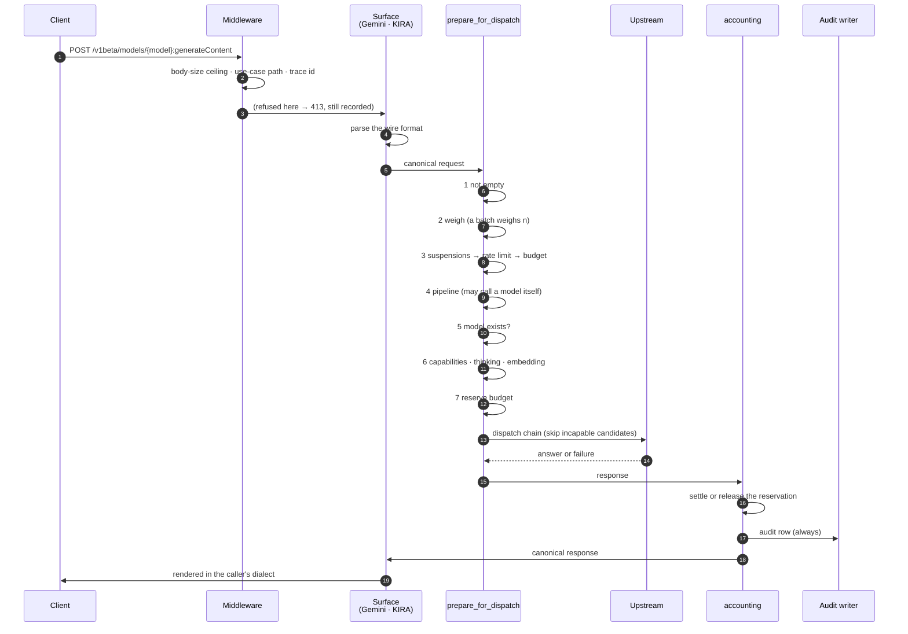
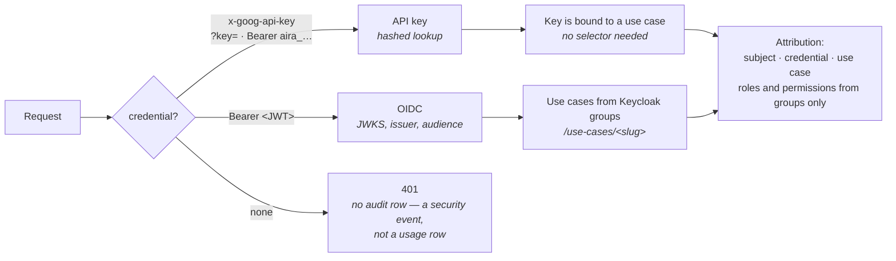
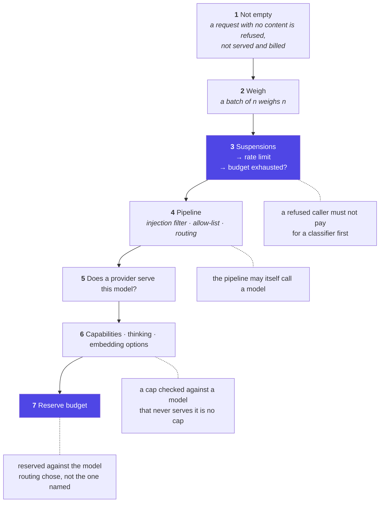
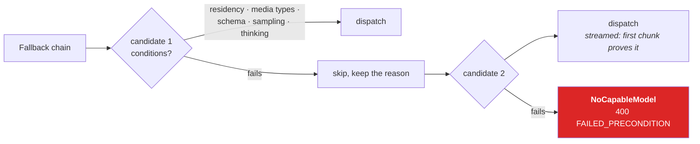
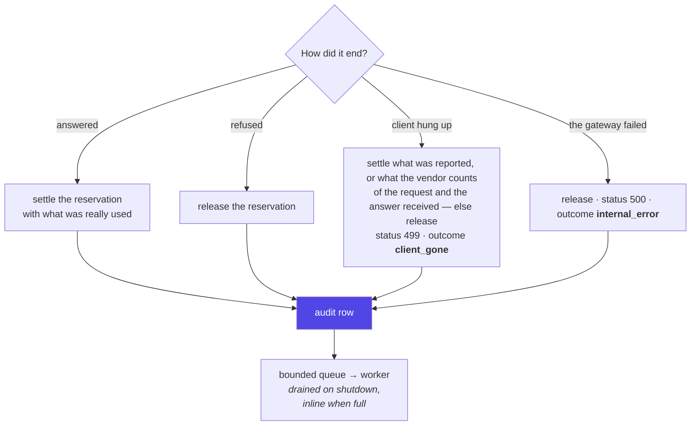
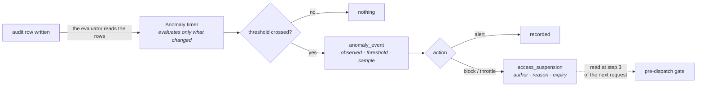

# One request, end to end

What happens between a client sending a prompt and receiving an answer — every control, in the
order it runs, and what each one costs if it is skipped.

The order is not incidental. It is owned by one function, `prepare_for_dispatch` in
[`gateway/src/aira_gateway/api/serving/prepare.py`](../gateway/src/aira_gateway/api/serving/prepare.py), because
**every guarantee this layer makes is a guarantee about the order**
([`FRD-126`](features/FRD-126-one-pre-dispatch-sequence.md)).

---

## 1. The whole path at a glance

---

## 2. Before any route: the middleware

Up to five things run outside the application, in this order (outermost first):

| Middleware                  | Does                                                   | If it refuses              |
| --------------------------- | ------------------------------------------------------ | -------------------------- |
| `TraceIdMiddleware`         | puts `x-trace-id` on **every** traced response         | —                          |
| `SecurityHeadersMiddleware` | `nosniff` · `no-referrer` · `DENY` · `no-store`        | —                          |
| `CORSMiddleware`            | the cross-origin headers, with `AIRA_CORS_ORIGINS` set | —                          |
| `UseCasePathMiddleware`     | reads `/uc/<slug>` from the path                       | 400 on an invalid slug     |
| body-size ceiling           | counts bytes, enforces `AIRA_MAX_REQUEST_BYTES`        | **413**, and records a row |

**The order is what decides which responses carry the headers.** The ceiling is enforced by
wrapping `receive`, so nothing above it buffers anything either way, and it is innermost: its 413
passes through every layer above it, headers, trace id and CORS included. It sits inside the path
selector, so it refuses on the path every route sees — `/uc/<slug>/kira/…` is a KIRA request when it
is too large too, answered in KIRA's envelope and audited as `api="kira"`. The one response no
middleware reaches is Starlette's answer to an unhandled error, a 500 written outside all of them;
its handler adds the security headers, the trace id, the KIRA surface's headers and the CORS
headers itself.

The ceiling has two exits — a declared `Content-Length` that is too large, and a body that lies and
is cut off mid-read — and **both record an audit row** under the outcome `request_too_large`. That
row carries **no identity**: the credential was never verified at that point, and recording an
unverified claim would let anyone write another system's name into the audit trail with one
oversized request ([`FRD-122` §12](features/FRD-122-complete-audit-trail.md)). It does carry where
the request came from, by the same trusted-proxy rule as every other row, and its size.

That size — the declared `Content-Length`, or the bytes counted when the body was cut off — is what
`payload_size` anomaly rules measure against, so it is carried onto the row rather than counted
twice. A declared length is the caller's own number, so it is recorded at most at what the column
holds.

---

## 3. Authentication and attribution

Two credential kinds, one `Principal`:

- An **API key** (`aira_<prefix>_<secret>`, hashed at rest) is bound to its use case. A mismatched
  `/uc` selector or `X-AIRA-Use-Case` header is a **403**, not a silent override.
- An **OIDC bearer** carries **group memberships, and roles are read from those and from nothing
  else** ([`ADR-0017`](adr/ADR-0017-a-role-is-held-through-a-group.md)): `AIRA_ROLE_GROUPS` maps a
  group path to a role, and a realm role assigned directly grants **nothing**. What a role allows is a
  permission set (`FRD-614`): the gateway resolves the token's groups against its `roles` read
  model, fed over `aira.roles` and cached for five seconds, and every installation-wide check asks
  one permission. This line said
  *"carries realm roles and group memberships"* until 2026-08-31 — the same sentence
  `aira_common/roles.py` opens by naming as a defect it had already made, surviving in the document
  a reader reaches for first. Use-case membership comes from a group grant or from the
  `/use-cases/<slug>` convention; a non-member gets 403.
- The **credential identity** (an API key's prefix, or the OIDC client id) travels onto the audit
  row separately from the subject. Without it, five keys issued for one use case by one person are
  one identity in the log, and a leaked key can be revoked but its blast radius cannot be assessed.

A **401 leaves no audit row**, and that is a decision: an unauthenticated request is a security
event, not a usage row attributed to nobody.

---

## 4. The pre-dispatch sequence

Seven steps, one owner. The right-hand column is what breaks if the step moves.

### 3 — the gate every verb passes

`guard_before_work` checks, in order: **suspensions** (is this caller stopped?), **rate limits**
(token bucket, all-or-nothing across use-case and member scopes), and **already over budget**.

A request that names **no** use case is not exempt: it books against the installation's own budget
(`FRD-610`), the residual bucket for spend no use case owns — the console's model checks, a
break-glass key, demo traffic. Until that scope existed, such a request passed the gate untouched
because there was nothing for it to be counted against.

A per-head allowance is counted against the **person**, not the credential: an API key and a
Keycloak sign-in by the same human share one budget and one bucket
([`ADR-0019`](adr/ADR-0019-an-allowance-belongs-to-a-person.md)). A suspension is the exception and
deliberately so — it aims at exactly what it names, so blocking a leaked key does not block the
person holding it.

It is called once, _before the verb branch_. Putting it inside the pipeline would have been tidier
and would have left `:embedContent` unlimited — embeddings have no pipeline. That verb is the reason
this project writes controls on the path every branch takes rather than inside one of them
([`FRD-405` B3](features/FRD-405-rate-limiting.md)).

**Cost of getting this wrong, measured:** with the pipeline running first, one served request and
seven refused ones spent 72 400 against a 20 000 cost limit — the refusals cost more than the answer.

### 4 — the pipeline

Per use case, config-driven, authored in the SPA's graph builder
([`FRD-300`](features/FRD-300-pipeline-engine.md),
[`FRD-303`](features/FRD-303-pipeline-builder-ui.md)):

| Step               | Does                                       | Notes                                                             |
| ------------------ | ------------------------------------------ | ----------------------------------------------------------------- |
| `injection_filter` | heuristic patterns, or an LLM classifier   | verdict is **three-valued**; `undetermined` **blocks** by default |
| `model_route`      | an LLM classifier picks a category → model |                                                                   |
| `pii_filter`       | a trusted model rewrites the user's text   | **blocks** by default when it cannot; the caller is told ([`FRD-309`](features/FRD-309-pii-filter.md)) |

**What the filter reads — worth stating, because each is a limit of *reach* rather than of
verdict.** Its `scope` defaults to `user`, which is **the last user message**: an injection planted
in an earlier turn of a conversation is not re-scanned when the next one arrives. A conversational
use case should set `system_user`, which reads every system and user message; a scope the gateway
does not know reads them all as well, and an `action` it does not know blocks. No scope reads
**attachments** — the text view of a message excludes them ([`FRD-110` §8](features/FRD-110-multimodal-content.md)),
so an injection inside a PDF is invisible to every step here. And the **heuristic reads at most
`MAX_SCANNED_CHARS` (20 000) characters of a text — its first and last 10 000** when it is longer:
the patterns run on the event loop and one unbounded repeat costs time in the square of what it
reads. What lies between the two ends is not scanned; the dry run shows how much, and the gateway
logs `injection_scan_partial`. None of these is a bug; each is the difference between "the filter
ran" and "the prompt was checked", and a reader who assumes the second has been misled by omission.

**The PII filter rewrites the last user message only** ([`FRD-309`](features/FRD-309-pii-filter.md)
FR-2). A chat client sends the whole conversation every turn, and its own copy of earlier turns was
never redacted — so from the second turn on, what the caller typed earlier reaches the model and the
stored payload as it was typed, while the step records `unchanged` or `redacted` for the last one.
A stated blind spot, like the filter's scope above.

**An embedding runs the steps that are about the text it carries, and not the others.** A step
about the *answer* has nothing to act on — a router chooses a model to generate with, and an
injection filter is about a prompt that will be **obeyed**, which an embedding never is. A step
about the *text itself* applies exactly as it does to a prompt, so a `pii_filter` runs on
`:embedContent`, `batchEmbedContents` and `/kira/api/external/embed`
([`FRD-309`](features/FRD-309-pii-filter.md) FR-9). Every text of a batch is offered to the
redactor and one that cannot be redacted refuses the whole request: half a batch of vectors is not
an answer. Until 2026-08-27 an embedding ran **no** step at all, so a use case that had switched on
redaction embedded and stored its callers' text untouched — `FRD-300` recorded embeddings as a
non-goal when the steps were a filter and a router, and `pii_filter` arrived into the same branch
later, inheriting a decision that was never made about it.

There is no `allow_check` step: which models a use case may call is a property of the use case
([`FRD-308`](features/FRD-308-use-case-model-release.md)), checked as a dispatch condition at every
hop. As a step it ran once, before routing — so a route or a fallback went straight past it.

Every model a pipeline names — the classifier a filter runs, the classifier a router runs, each
category's target, the default target, the fallback chain — must be **released to the use case**.
Refused when the pipeline is saved and again at dispatch, and the builder offers only those. The
dry run follows the same rule and the membership rule with it: it calls a real model, so it belongs
to a use case exactly as a request does — and it asks the installation's own approval
([`FRD-307`](features/FRD-307-model-catalog.md)) of every model it will *call*, which the release
alone could not: the release has a "nobody has told us" state and approval has none. **Trying a
pipeline is authoring one**: an unsaved pipeline, and steps run past a block, are for the use case's
administrators; a member may test the saved pipeline and sees what each step decided, not what its
model wrote. A malformed `pipeline` is a `400` naming the field.

**A step reaches only the models written in its own configuration.** One that names none used to
borrow the first model in the registry — a model nobody chose, which no gate covers, since none of
these conditions sits on a step's *own* call. It degrades instead: the redactor blocks, the LLM
filter falls back to the heuristic, the router uses its `default_model`.

Since 2026-10-11 a step may name **more than one**: its own `fallback_models` chain
([`FRD-302`](features/FRD-302-model-fallback.md) FR-7), tried in order where the model before it
could not be *reached*. Reached, not agreeable — a model that answered `UNDETERMINED`, or returned
a rewrite too short to trust, has answered and the chain stops, because a filter that kept asking
until some model agreed would get weaker exactly when things get worse. What a chain adds is a
candidate; what it never removes is the safe direction above. Every name in it is checked against
the release like every other, which is what lets a step's own call apply no dispatch condition.

Then a `fallback_models` chain. **A pipeline model call is a first-class request**: it leaves its own
audit row named `pipeline:<step>`, priced, and booked against the budget **as a request** — it
reached a model and cost money, so a use case running two steps per request is doing three times the
work its request budget was sized for. It does **not** take a rate-limit token: a bucket measures how
fast requests arrive, and the gate above is taken once, on the one request that did
([`FRD-125` FR-9b](features/FRD-125-pipeline-verdicts.md), owner's decision 2026-08-15). Measured
against a real model, the classifier costs roughly as much as the answer it guards.

A filter that ran and **passed** records that it did: "found nothing" and "none configured" used to
look identical.

### 6 — capabilities, per hop

The catalog is a **runtime authority** ([`FRD-114`](features/FRD-114-model-capability-metadata.md)):
output cap, per-model default cap, `generate`/`embed`, thinking modes, structured output,
attachments, deprecation. **Undeclared means the baseline and nothing more** — absence of
information is not permission.

Checked **after routing and at every hop of the fallback chain**, because a chain that quietly
answers with less than was asked for returns a 200.

**One capability is deliberately not a condition**: `prompt_caching`
([`FRD-133`](features/FRD-133-prompt-caching.md)). Every other flag guards the _answer_ — a
candidate that cannot read the attachment would answer about a document it never saw, so the chain
moves on. A candidate that cannot cache answers exactly the right thing and merely costs more, so
it is served **uncached** rather than skipped: refusing a request over a price is the opposite of
what a fallback chain is for. Resolved here all the same, because whether the request carries a
cache marker depends on the model it landed on and on the use case's own switch and lifetime.

### 7 — the reservation

Budgets **reserve** before dispatch and settle or release afterwards
([`FRD-405`](features/FRD-405-rate-limiting.md)). Without it, N concurrent requests all pass a limit
with room for one — proved by a test pair: 20/20 passed the old path, 1/20 the new.

What is reserved is the request's **whole** expected consumption: the output cap that will be sent
and a thinking budget (output), and the prompt — counted at four characters a token — with each
attachment at what the model declares (input), each side at its own price. A reservation of the
output alone let a dozen agentic requests, each carrying a 100 000-token context, all pass a
50 000-token limit together.

---

## 5. Dispatch

A candidate that fails a condition is **skipped with its reason kept**, and the reasons reach the
audit row — as does a candidate that was *tried* and failed, with what the upstream said
([`FRD-302`](features/FRD-302-model-fallback.md) FR-11): until `ADR-0032` the row could say that a
fallback had answered and never why the model before it had not. An exhausted chain is a
**400 FAILED_PRECONDITION**, not a 502: "every candidate was excluded" is fixable by an operator,
an outage is not.

**A streamed request uses this chain too**, and did not until 2026-10-11 — it resolved exactly one
adapter, so the availability a second model is configured for did not exist on the verb every chat
client uses. The chain is *opened* rather than awaited: for each candidate in turn, the conditions,
then the upstream stream, then its **first chunk** — the `__anext__` that issues the HTTP request.
A candidate that fails before producing that chunk is passed over; the one that produced it owns
the rest of the answer. Two things follow. The response does not begin until a model has produced
something, so a streamed request nothing can serve is a **status** rather than a `200` whose body
is an empty array; and once a chunk is on the wire the stream is **committed**, because text from
two models spliced into one answer would be worse than the failure it hid.

Five conditions share this mechanism rather than each inventing one: **residency**
(one policy for every cloud), **media types**, the **schema** capability, **thinking**, and
**sampling expressibility** — the last is a property of the _dialect_, since no catalog entry can
say whether `top_k` exists.

A candidate whose **wire format cannot carry** the request — found while its body is built, one
step after the conditions: a thinking budget that does not fit Anthropic's output cap, thinking on a
Claude turn that continues a function call — is skipped the same way, by name. Where every candidate
was skipped for that reason, the dialect's own refusal is the answer (a `400` naming what to
change). And a stream counts as **failed**, not finished, when the provider reports an error inside
its `200` or the connection breaks: before the first chunk the chain moves on, after it the audit
row says `upstream_error`, what was reported is settled, and a Gemini client receives Google's own
error element as the stream's last — which the google-genai SDK raises, where a stream that merely
stopped would read as a complete answer.

**The rule that matters:** a model that cannot read the attachment is refused **by name**, never
sent the prompt without it. A dropped attachment produces no error — it produces a fluent wrong
answer with a 200, and the caller blames the model.

---

## 6. After the answer: `accounting`

One context manager owns every way out ([`FRD-128`](features/FRD-128-one-post-dispatch-sequence.md)):

The audit row carries: who and what system, which use case, requested **and** served model, how the
model was chosen, provider/publisher/**region**, status and outcome, pipeline decisions, tokens,
latency, cost in nano-units, request bytes, trace id, and which controls were degraded at the time.

**A request that reached this point is recorded however it ended.** Four of six paths once lost the
row when a caller went away mid-answer; a dropped socket _cancels_ the response task, so settling or
releasing the reservation and writing the row run to their end as one unit
(`shielding.uninterrupted`). Shielding the wait was not enough: Starlette cancels a streamed body
through anyio, whose cancellation is re-delivered to every await in the cancelled scope, so control
left the exit while the settle still ran and the reservation was resolved twice. A stream whose body
never began — cancelled while its headers were sent — is accounted for by its response instead
(`AccountedStream`).

A refusal raised **after** the upstream answered — a document the model did not finish — was paid
for: what it spent is settled, and its row carries the tokens and the cost.

**A stream left before its vendor said what it used is counted, not estimated**
([`FRD-128`](features/FRD-128-one-post-dispatch-sequence.md) FR-6). Vertex's Gemini reports usage
only in a stream's last chunk, so in the exit — the caller gone, nobody waiting — the vendor's own
free token count is asked for the request as it was sent and the answer as it was received, in the
region that answered. That is booked as a **floor** and the row says so (`usage_basis`): the answer
the vendor produced after the caller left is in no count, and reports call the spend a lower bound.
A vendor that cannot count, a count that fails, or `AIRA_COUNT_CANCELLED_STREAMS=false` leaves the
usage unknown and releases the reservation.

**Refusals are recorded at the route's exception boundary** — one site, because a fact repeated at
every `return` is a fact eventually forgotten at one of them.

---

## 7. Asynchronously, afterwards

Detection is **asynchronous**, enforcement is **synchronous**, and they meet at a written decision
([`ADR-0014`](adr/ADR-0014-detection-is-asynchronous-enforcement-is-not.md)). The evaluator reads
the same rows the report reads — so it also sees refusals, which is where much of the signal is: a
thousand rate-limited requests _is_ the anomaly.

Also afterwards: the **retention worker** deletes stored prompts and responses once the use case's
period has passed (default 7 days). It must be scheduled or nothing is deleted.

---

## 8. What the caller sees when something refuses

| Situation                         | Status                                         | Outcome recorded            |
| --------------------------------- | ---------------------------------------------- | --------------------------- |
| Body over the ceiling             | 413                                            | `request_too_large`         |
| No credential                     | 401                                            | _(none — a security event)_ |
| Not a member of the use case      | 403                                            | `invalid_request`           |
| Stopped by a rule or an operator  | **429** + `Retry-After`                        | `suspended`                 |
| Over the rate limit               | 429 + `Retry-After`                            | `rate_limited`              |
| Over budget                       | 429                                            | `budget_exceeded`           |
| Use case retired                  | 403                                            | `invalid_request`           |
| Blocked by the pipeline           | 403                                            | `blocked_by_pipeline`       |
| No candidate could serve it       | 400 `FAILED_PRECONDITION`                      | `no_capable_model`          |
| Unknown model                     | 404                                            | `model_not_found`           |
| Field this gateway does not serve | 400, **naming the field**                      | `invalid_request`           |
| Declared, but the dialect has no field for it | 400 `FAILED_PRECONDITION`, **naming the reason** | `invalid_request`           |
| Upstream said 400                 | 400 `FAILED_PRECONDITION`, carrying its reason | `upstream_error`            |
| Upstream 401/403                  | 502, **masked**                                | `upstream_error`            |
| Document left incomplete          | 502, with what it cost                         | `upstream_error`            |
| This gateway failed (a defect)    | 500                                            | `internal_error`            |
| Caller hung up                    | —                                              | `client_gone`               |

Two rules behind that table. **Nothing a request asks for is silently dropped**: a field this
gateway cannot honour is refused _by name_ with the reason, or the candidate is skipped — never
accepted and ignored. And an upstream's **credential** failures stay masked, because they are _our_
credentials, the caller cannot act on them, and the message may name one.

---

## 9. Where to look when something is wrong

| Question                       | Where                                                                |
| ------------------------------ | -------------------------------------------------------------------- |
| What happened to this request? | `request_logs`, by `trace_id` (also on the response as `x-trace-id`) |
| Why was it refused?            | the `outcome` column, and `pipeline_decisions`                       |
| Was a control degraded?        | the `degraded` column on that row                                    |
| Is anything stopped right now? | `GET /v1beta/suspensions` (`incident.suspend`)                       |
| What has the detector found?   | `GET /v1beta/anomalies`                                              |
| Is the gateway healthy?        | `/healthz` (liveness), `/readyz` (readiness + upstream probes)       |
