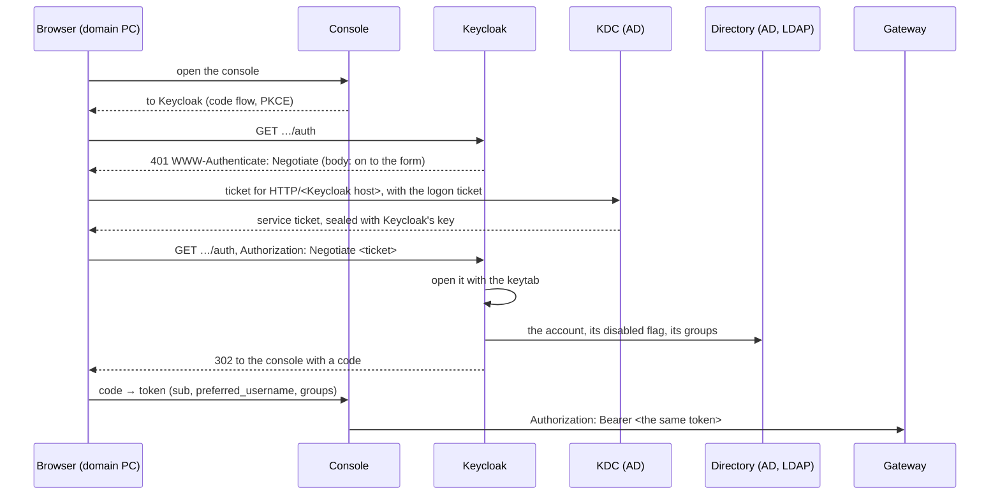

# FRD-140 — Windows sign-on, proven for the console and the gateway

> Phase: 1 (platform) · Status: **Built** · Owner: Vadim Scheibe
> Origin: the owner asked whether people could sign in with their Windows identity instead of a
> username and a password — their accounts already reach Keycloak from AD over LDAP — and asked for
> it to be proven for both components, for the people who get in and for those who must not, with
> tests.
> Related: [`ADR-0035`](../adr/ADR-0035-windows-sign-on-is-keycloaks.md) (the decision),
> [`FRD-101`](FRD-101-auth-apikey-oidc.md) (the two credentials),
> [`FRD-209`](FRD-209-access-by-group.md) (a use case granted to a group), `ADR-0017` (roles from
> groups), `ADR-0007` (a person is their `sub`), [`docs/INTEGRATIONS.md`](../INTEGRATIONS.md) §2,
> *Windows sign-on* (what an installation sets)

## 1. Summary

A person at a PC of the Windows domain opens the console and is in — no form, no password — and the
token the console then holds is accepted by the gateway like any other. **Nothing in AIRA changes
for it** (`ADR-0035`): the browser presents the Kerberos ticket Windows gave the person at logon,
Keycloak decrypts it with its own key, finds the person in AD through the federation it already
has, and issues the tokens a password would have produced.

What is built here is the **proof**: a stand-in domain in the development stack, a tool that makes
both administrators' changes against it, and a browser suite that signs people on with their
ticket — and refuses the people who must not get in — on both components. Building it found what
decides *when somebody is out* (§5.4), which matters to an installation that federates its AD
whether it ever uses Kerberos or not.

## 2. Goals & Non-Goals

**Goals**
- In a real browser, against a real KDC and directory: a person of the domain with a ticket is
  signed in to the console without any form, holding the role their AD group gives them.
- The token of that sign-on is accepted by the gateway for a use case granted to the person's AD
  group, and refused for somebody outside it.
- Who does not get in, each shown: no ticket; a browser not told to trust Keycloak; an account
  disabled in AD, also with a ticket issued before; an account outside the part of AD Keycloak
  reads; a ticket for a key Keycloak does not hold.
- When a change in AD takes effect — a role taken away, a department left, an account disabled —
  within a bound that is stated and tested.
- The list an installation follows, with what each failure looks like (`docs/INTEGRATIONS.md`).

**Non-Goals**
- **Kerberos in AIRA**, at the gateway or the console's API (`ADR-0035`).
- **Windows itself.** The stand-in is Samba; a browser policy rolled out by GPO, the intranet zone
  and Windows' own logon are stated in the guide, not proven.
- **Signing on without a browser.** A script or a coding assistant keeps an API key (`FRD-101`).
- **Changing an installation's Keycloak.** The tool configures the development realm and refuses
  every environment but `local` and `demo`.

## 3. User Stories

- As **a person at a domain PC**, I open the console and I am in, with my roles.
- As **IT security**, I disable an account or take somebody out of a group in AD and know by when
  they can no longer reach AIRA.
- As **the Keycloak and AD administrators**, I have the exact fields to set, and for each way it
  fails, the line Keycloak logs.

## 4. Functional Requirements

- **FR-1 — A domain beside the stack.** `deploy/compose/ad`: Samba as an AD domain controller
  (realm `AIRA.TEST`), behind the profile `windows-sso` in `docker-compose.showcase.yml`. It holds
  what an installation's AD already has: `OU=People`, `OU=Roles` with the realm's three role groups,
  `OU=Departments` with the realm's two departments, an LDAP bind account, and the mail domain as an
  alternative UPN suffix. Its KDC is published (`AIRA_PUBLISH_KDC_PORT`, `1088`) for the browser
  that stands in for a workstation. Provisioning is atomic: a domain whose provisioning stopped
  half-way is made again from nothing.
- **FR-2 — The domain's half** (`tools/windows_sso.py`): an account of its own for Keycloak's
  service principal, the SPN `HTTP/<host of AIRA_OIDC_ISSUER>`, AES keys only, and the keytab —
  exported, and handed to Keycloak as a file only Keycloak may read.
- **FR-3 — The realm's half**: the domain as a read-only federation that registers nobody in AD;
  Kerberos allowed; the *Kerberos principal attribute* empty, set by an edit after creation because
  Keycloak fills `userPrincipalName` in when it creates one; `sAMAccountName` as the username; only
  `OU=People` read; a **bounded cache** (`MAX_LIFESPAN`); role groups onto `/aira`, departments onto
  `/abteilungen`, membership AD's alone; the *MSAD account controls* mapper made sure of; the
  browser flow's *Kerberos* step checked to be `ALTERNATIVE`. Applied as an **edit** where the
  federation exists, as an administrator would make it.
- **FR-4 — Taken away again.** `remove` deletes the federation, which removes the people it
  imported and turns the *Kerberos* step back off — checked, not trusted.
- **FR-5 — Only where the realm is a fixture.** `apply` and `remove` refuse every environment but
  `local` and `demo`, like the realm repair (`tools/keycloak_demo_realm.py`).
- **FR-6 — The browser suite** (`e2e/windows-sso`, `make test-windows-sso`) makes every person it
  needs in the domain and removes them, and opens one browser per person — a workstation of the
  domain holding that person's ticket, or none. Its global setup refuses, never skips, when the
  domain is not running or Chromium cannot load MIT Kerberos; it applies the realm's half with a
  **10-second** cache lifespan so a revocation can be watched to its end, and its teardown removes
  that half again, passed or not.
- **FR-7 — CI runs it** after the browser suite, in the stack job.

## 5. Design & Architecture

### 5.1 The sign-on

A browser that cannot answer `Negotiate` renders the 401's body, which sends it on to the form.

### 5.2 The workstation

The browser the suite drives is Playwright's Chromium on the test runner, given three things a
domain PC has: a **credential cache** holding the person's logon ticket (obtained with `kinit` on
the domain controller and copied out), a **`krb5.conf`** naming the realm and the published KDC
(`tools/windows_sso.py workstation`), and **`--auth-server-allowlist=<Keycloak host>`** — the
command-line form of the `AuthServerAllowlist` policy. It asks the KDC for Keycloak's service ticket
itself, as Windows does. A cache is always named, even when empty, so that a ticket the machine
running the suite happens to hold can never stand in for the one a test meant.

### 5.3 Measured on the way

- **The host in the service principal is the host as typed.** MIT Kerberos appended the machine's
  search domain to `localhost` (`qualify_shortname`) and asked for a principal nobody had
  registered; the workstation's `krb5.conf` turns every rewrite off, which is also how Windows
  behaves.
- **A UPN in the mail domain hides a person from a lookup by UPN.** With the *Kerberos principal
  attribute* set to `userPrincipalName` — Keycloak's default for AD, filled in on creation even when
  the field is sent empty — a person whose UPN is `name@firma.example` and whose ticket is
  `name@AIRA.TEST` was not found and got the form. Empty, Keycloak matched the account name. The
  suite's people all carry the mail-domain suffix, so the default fails it.
- **RC4 fails everybody.** An account without AES is issued RC4 tickets; Keycloak's Java refused
  them and every sign-on fell back to the form.
- **A ticket for any SPN of the account opens with its key.** A principal configured for another
  host still accepted tickets while the old SPN stayed registered on the same account: the key is
  the account's, and Keycloak does not compare the ticket's service name. What enforces the host is
  the KDC, which issues no ticket for a name nobody registered.
- **Keycloak does not need a `krb5.conf`.** It only accepts tickets, with the keytab, and never
  asks the KDC; the keytab is all it is given.

### 5.4 When somebody is out

Measured first against a throwaway Keycloak and then against the development realm:

| Keycloak's cache policy | Disabled in AD — the session renews? | Taken out of a group — the next token? |
|---|---|---|
| default | **yes**, until the cache entry is evicted | **keeps the group**, on a fresh Kerberos sign-on too |
| *Max lifespan* 20 s | refused (`User disabled`) after the lifespan | without the group after the lifespan |
| *No cache* | refused at once | without the group at once |

The default has no bound at all; a bounded lifespan makes the delay a number: access ends at most
*lifespan + one access-token lifetime* after the change in AD (5 + 5 minutes by default). The
gateway accepts a token until it expires — a refused renewal is what ends a session. This is a
property of the federation, not of Kerberos: a password sign-on through it behaves the same, which
is why the guide states it for every installation that federates AD.

A person disabled in AD is kept out by the *MSAD account controls* mapper and by nothing else:
deleted, a disabled person signed on with a ticket issued before and went on renewing their session.

## 6. Data Model

None in AIRA. In Keycloak, the federation imports a person on first sign-on; their `sub` is the id
of that imported account, and AIRA binds them to it (`ADR-0007`). Deleting the federation deletes
those accounts — which is why the tool edits it in place, and why the guide says never to recreate
an installation's.

## 7. API / Interface Contract

- `make windows-sso-up` — start the domain, then `tools/windows_sso.py apply`;
  `make windows-sso-down` — `remove`, then stop the domain; `make test-windows-sso` — start the
  domain, run the suite, purge its use cases.
- `tools/windows_sso.py apply [--cache-lifespan SECONDS] | remove | keytab | facts | workstation`.

## 8. Security & Privacy

- **No change to what AIRA processes.** The tokens carry the same claims; the ticket and the
  principal name are Keycloak's. The privacy register and texts are unchanged (`FRD-625`).
- **Fails safe.** No ticket, no trusted browser, a stale keytab: the form, never an error and never
  a lock-out.
- **The keytab is a key of the domain**: handed to Keycloak as a file only Keycloak may read
  (`umask 077`), as an installation keeps it.
- **The stand-in is not a template for the transport**: its LDAP accepts a simple bind in plain
  text inside the stack's network. Its bind password is random per domain, kept in the container,
  and never printed.

## 9. Observability

Keycloak logs each failure as a warning; `docs/INTEGRATIONS.md` §2 maps each line to its cause.
*Received kerberos token, but there is no user storage provider that handles kerberos credentials*
follows every failure and names none — the cause is the line before it.

## 10. Testing & Acceptance Criteria

**The browser suite** (`e2e/windows-sso`, 10 tests, about 75 seconds):

| Component | Gets in | Does not get in |
|---|---|---|
| console | with a ticket, no form, holding the AD group's role; without a ticket, through the form with the domain password | no ticket (the form); a browser not told to trust Keycloak; disabled in AD, also with a ticket from before — and no new ticket from the KDC; outside `OU=People`; a ticket for a key Keycloak does not hold, then in once the key is exported again; a role taken away in AD, within the bound; a disabled account's renewal, within the bound |
| gateway | the sign-on's token, for a use case granted to the person's AD department: `me/budget` names the domain account, and `mock-1` answers | a person of another department: `403`, compared after the member was let through; no token: `401`; a person taken out of the department, within the bound |

**Each property broken on purpose, each caught** — against the development realm, by editing the
tool the suite applies: Kerberos off · lookup by UPN · the default cache · no role groups · the
whole domain as the search base · RC4 only · no departments · an SPN for another host (with a fresh
domain; see §5.3) · the *MSAD account controls* mapper deleted.

**Hermetic** (`tools/tests/test_windows_sso.py`, 18 tests, in `make test`): the federation's
properties, the AES bits, the principal following the issuer, the workstation's `krb5.conf`, the
environment guard, and the facts the domain, the realm file, Compose and the suite must agree on.
Mutations `WSSO-1`–`WSSO-15`, all caught.

**Acceptance**
- *Given* a person in `OU=People` and in AD's `it-steuerung`, logged on, at a browser that trusts
  Keycloak, *when* they open the console, *then* they are in with no form and hold the role.
- *Given* the same person disabled in AD, *when* their browser presents a ticket issued before,
  *then* the form is shown and nobody is signed in.
- *Given* a use case granted to `/abteilungen/kundendienst`, *when* a member of AD's `kundendienst`
  calls the gateway with their sign-on's token, *then* `mock-1` answers; *when* anybody else does,
  `403`.
- *Given* a person taken out of that group, *then* within the cache lifespan their next token is
  refused by the gateway.

## 11. Dependencies & Risks

- Chromium loads `libgssapi_krb5.so.2` at run time and answers no `Negotiate` without it; the
  suite's setup refuses with the package to install.
- The development realm is shared: the suite gives it a federation for its length only. A run that
  is killed leaves it; `make windows-sso-down` takes it away.
- Recreating the domain makes a new one — new keys, a new bind password — which `apply` follows
  every time it runs. A recreated Keycloak has lost its keytab; `apply` (or `keytab`) hands it
  over again.

## 12. Rollout / Demo

`make test-windows-sso` is the demonstration: it brings the domain up and shows both components,
both ways. `make windows-sso-up` leaves the realm federated, with a five-minute cache, for trying
it by hand; `make windows-sso-down` restores the realm.
