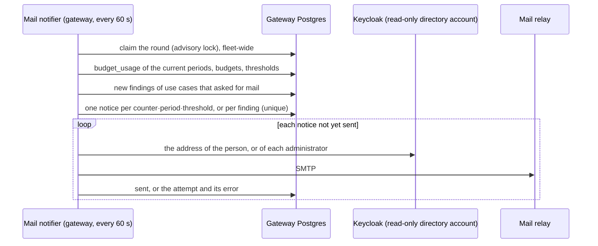

# FRD-409 — A mail when a budget runs low, and when a use case's anomaly rule fires

> Phase: 4 (Budgets) · Status: **Built** · Owner: Vadim Scheibe
>
> Origin: the owner: people should get a mail when their budget is exceeded, at the address in
> their Keycloak profile. A use case's administrators set the thresholds, and the mails are in
> English. Administrators should also be able to have themselves told about their use case's
> anomalies.
> Decision: `ADR-0050`. Related: `FRD-400`/`FRD-401`/`FRD-403` (budgets), `FRD-407` (a person's
> own budget), `FRD-402` (the budgets tab; this is its open follow-up), `FRD-139` (a caller's own
> allowance), `FRD-500`/`FRD-501`/`FRD-503` (anomaly rules, findings, what is done),
> `FRD-209` (the directory), `FRD-627` (strict data mode), `FRD-625` (privacy notice), `FRD-629`
> (the installation's clock).

## 1. Summary

Today a budget that runs out is a 429, and nobody is told before. Once an installation names a mail
relay, the gateway sends mail in two cases. The first is a budget crossing one of its use case's
thresholds. The person whose own allowance it is gets the mail, or, for the use case's shared
budget, its administrators do. A use case's administrators set the thresholds, and the default is
100 %, the moment a budget is used up. The second case, if a use case's administrators switch it
on, is one of the use case's anomaly rules finding something; the mail then goes to those
administrators. The address is read from the person's Keycloak profile when the mail is sent, and
is not stored.

## 2. Goals & Non-Goals

**Goals**
- Thresholds per use case, in percent of a budget, set by its administrators. The default is
  `[100]`; an empty list means no budget mail for that use case.
- One mail per counter, period and threshold, never one per request. When several thresholds are
  crossed at once, only the highest is sent.
- A per-person counter is mailed to that person: the budget each member has, or one set for them
  alone. The use case's shared budget is mailed to its administrators.
- A switch per use case, on by default, that mails its administrators when its anomaly rules
  find something: one mail per use case and round, naming no person, key or address.
- Off unless the installation configures a relay. Nothing refuses to start without one.
- English.

**Non-Goals**
- The installation's own budget (`FRD-610`): it belongs to no use case, so there is nobody to tell
  but the operators, who see it in the console.
- Findings of a global rule about one person or key. They belong to no use case and stay in the
  security console, where they are today.
- Thresholds per budget row, a person opting out, and channels other than mail (chat, webhooks).
- Telling every member when the shared budget runs out. Their refusal says which budget and when
  it resets (`FRD-628`), and the administrators, who can raise it, are told.

## 3. User Stories

- As a **member** of a use case, I want a mail when my budget is used up or nearly so, so that I
  know why my requests are refused and when they work again.
- As a **use case administrator**, I want to say at which shares of a budget mails go out, so that
  my members hear before the wall rather than at it.
- As a **use case administrator**, I want a mail when the shared budget runs low, so that I can
  raise it before everybody is stopped.
- As a **use case administrator**, I want a mail when an anomaly rule fires in my use case, so that
  I do not have to keep the Warnings tab open.
- As an **operator**, I want all of it to switch on when I name a relay, and the log to say what
  was sent and what was not.

## 4. Functional Requirements

- **FR-1 Thresholds.** A use case has `budget_mail_thresholds`: up to five whole percentages from 1
  to 100, distinct, kept ascending. The default is `[100]`, and empty means no budget mail. Whoever
  may change the use case's settings may change them: its administrators.
- **FR-2 Which counters.** Every enabled budget of a live use case is read against the counter the
  gateway enforces with, in the current period on the installation's clock. The share is the
  largest across its capped dimensions (cost, tokens, requests) of used ÷ limit. A lifted budget
  mails nobody, because it stops nobody.
- **FR-3 Who.** A per-person counter is mailed to that person, about the budget that binds them
  under the hierarchy (`ADR-0044`): somebody with a budget of their own hears about that one, not
  the one it replaced. The shared budget is mailed to the use case's administrators: everybody
  granted the role by name, and the members of every group granted it.
- **FR-4 Once.** One mail per counter, period and threshold, however many gateway instances run and
  however often they restart. Several thresholds crossed between two rounds send the highest only.
  A threshold added mid-period that the counter has already passed is mailed once, saying the share
  reached.
- **FR-5 What a budget mail says.** It names the use case, which budget it is (shared, each
  member's, or set for this person alone), the period, the amount used and the limit for each capped
  dimension (cost in the installation's currency), when the budget resets on the installation's
  clock, and what happens at the limit: requests refused until the reset, or nothing where the
  installation does not enforce budgets. It never gives another person's figures.
- **FR-6 Anomalies.** A use case has `mail_admins_on_anomalies`, true by default: the administrators are
  told without having to ask, and may switch it off. When it is on,
  every finding recorded for the use case goes to its administrators: one mail per use case and
  round, listing for each new finding the rule, its kind, the value measured against the threshold,
  over how many requests and minutes, what was done, and whether it concerned a person, a key or
  the use case. **It never says which person, key or address.** A mail is read where the console's
  rules do not reach, and the Warnings tab shows each reader what they may see.
- **FR-7 The address.** The address is read from Keycloak when the mail is sent, by exact username,
  through the read-only directory account Management already uses (`AIRA_DIRECTORY_CLIENT_ID`).
  Group members are read the same way. With no address on the profile, or no directory configured,
  nothing is sent and the log says why.
- **FR-8 Delivery.** Mail goes out over SMTP through the relay the installation names: host, port,
  STARTTLS, TLS or neither, and an optional login, from `AIRA_MAIL_FROM`. A relay that refuses or
  cannot be reached is tried again on later rounds, up to five attempts, while the period is
  current. A notice whose period has ended is dropped rather than sent late.
- **FR-9 Off by default.** Without `AIRA_SMTP_HOST` and `AIRA_MAIL_FROM`, nothing is checked, stored
  or sent. Neither a missing relay nor an unreachable one stops start-up or readiness. A host set
  without a sender is reported once at start.
- **FR-10 Links.** With `AIRA_CONSOLE_URL` set, a mail links the use case's Budgets or Warnings tab.
  Without it, the mail names the tab.
- **FR-11 The console.** The Budgets tab shows and edits the thresholds, and the Warnings tab the
  switch. Both say who receives the mail, and say plainly when the installation sends no mail at
  all: a setting that does nothing must not look as though it works.

## 5. Design & Architecture

Both kinds of mail start where their facts are: the budget counters and the anomaly findings are
the gateway's. Nothing flows from the gateway to Management (`ADR-0050`), so the gateway checks and
sends, as a background task beside the anomaly evaluation:

- **One notifier per round across the fleet.** The round is claimed with a transaction-scoped
  advisory lock, like the anomaly evaluation's, and held by a session of its own while the work
  commits notice by notice. A crash releases the lock with its connection.
- **At least once.** A notice is marked sent after the relay accepted it. If the gateway loses its
  database between the two, the mail goes again on the next round. It is never silently lost.
- Mail is sent with the standard library's SMTP client in a worker thread, with a 15-second timeout,
  so a slow relay never holds the event loop.
- The gateway reads the configuration the way it reads every other use case setting:
  `usecase.upserted` carries both fields, and an absent field is the default on both planes, so an
  older Management changes nothing.

## 6. Data Model

- Management: `UseCase.budget_mail_thresholds` (a list of integers, default `[100]`) and
  `UseCase.mail_admins_on_anomalies` (default true).
- Gateway read model: `use_cases.budget_mail_thresholds` (JSON; NULL, from an older Management, is
  read as the default) and `use_cases.mail_admins_on_anomalies`.
- Gateway `mail_notices`, one row per mail owed: `kind` (`budget` or `anomaly`), `use_case`,
  `subject_key` (the counter's key, or the finding's id), `period_key`, `threshold`, `expires_at`,
  `outcome` (`""` while owed, then `sent`, `superseded`, `no_recipient`, `failed` or `expired`),
  `recipients`, `attempts`, `last_error` and `sent_at`. It is unique on
  (`kind`, `subject_key`, `period_key`, `threshold`), which is what makes FR-4 hold across
  instances. Rows are deleted 30 days after they expire.

## 7. API / Interface Contract

- `GET`/`PATCH /api/use-cases/{slug}/`: `budget_mail_thresholds` (array of integers) and
  `mail_admins_on_anomalies` (boolean). A threshold outside 1–100, a repeated one, or more than five
  is a 400 that names the field.
- Event `usecase.upserted`: both fields.
- Management `GET /v1/me`: `mail_enabled`, whether this installation sends mail at all.

## 8. Security & Privacy

- **The data plane now holds the directory account** (`ADR-0050`): read-only (`view-users`,
  `query-groups`), and used only by the notifier.
- A budget mail goes to the person it is about, or to the administrators about the use case's own
  figures. An anomaly mail names nobody. Under strict data mode nothing in either goes beyond what
  its reader may see in the console.
- No address is stored. The log names a notice by its id, never by its recipient.
- A new processing activity in the privacy notice (`FRD-625`): the address is read from the
  directory, the mail goes through the installation's relay, and one notice row is kept per counter
  and threshold until 30 days after its period.

## 9. Observability

Log events `mail_sent`, `mail_not_sent` (no recipient) and `mail_failed`, each with the notice's
id, kind, use case and attempt, plus `mail_off` once at start when a relay is named without a sender.

## 10. Testing & Acceptance Criteria

- Unit: thresholds and shares, the hierarchy, once only, highest only, lifted budgets, expired
  periods, retries, recipients by name and by group, the anomaly mail naming nobody, the SMTP
  conversation against a local server, and nothing at all without configuration.
- Integration: a mail catcher in the CI stack. A budget used up sends the person a mail at their
  Keycloak address.
- Console: unit tests for both controls, over the rendered DOM. No browser test yet: the panels
  change nothing another screen reads.
- Mutations for once-only, highest-only, the person's own counter, the anomaly mail's silence about
  people, and the period's end.

**Acceptance criteria**
- *Given* a use case with thresholds `[80, 100]` and each member's monthly budget of 10 EUR, *when*
  a member's spend this month reaches 8.20 EUR, *then* that member gets one mail saying 82 % and
  when the budget resets, and no further mail until 100 %.
- *Given* a member's spend jumps from 50 % to 100 % between two rounds, *then* exactly one mail
  goes out, for 100 %.
- *Given* the shared budget reaches 100 %, *then* every administrator gets the mail, including the
  members of an administering group, and no member does.
- *Given* `mail_admins_on_anomalies` is on and a rule fires about a person, *then* the
  administrators get a mail that names the rule and the measurement and not the person.
- *Given* no `AIRA_SMTP_HOST`, *then* no notice row is written and the console says no mail is
  sent.

## 11. Dependencies & Risks

- The installation needs a relay, a sender address, and a route from the gateway to the relay: one
  ticket. The directory account must exist, and profiles must carry addresses.
- An administering group of hundreds sends hundreds of mails. That is the grant's choice, and the
  log shows the count.
- At-least-once delivery (§5) can, rarely, send a mail twice.

## 12. Rollout / Demo

The showcase stack runs a mail catcher (Mailpit, `http://localhost:8025`), and the people of the
development realm have addresses. Four lines in `.env` point the gateway at it; CI's integration job
sets them, so a mail sent there is read through the catcher's own API.
